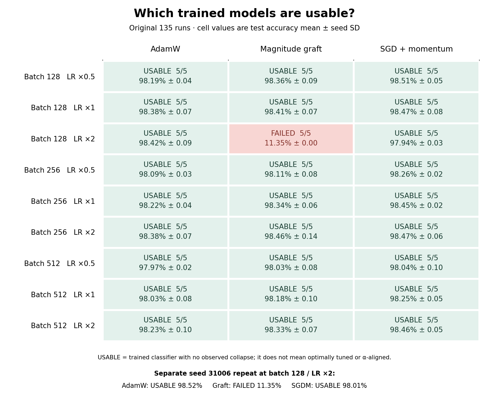
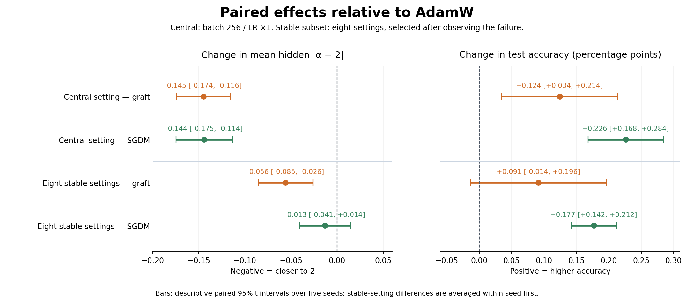

# Model status and results summary

**138 completed runs: 132 usable classifiers and six confirmed hyperparameter-setting failures.**

`USABLE` means the saved model learned classification and has no observed collapse. `FAILED` means checkpoint diagnostics confirm collapsed FC2 activations and constant predictions. These are functional labels, not a ranking by α, a claim of optimal tuning, or certification of the theory. The older `complete` labels in execution logs mean the run reached epoch 120; a completed run can still produce a failed model.

| Model status / comparison role | Count | Use |
|---|---:|---|
| USABLE, matched stable subset | 120 | Main comparison: eight shared settings × five paired seeds × three arms |
| USABLE, controls at failed setting | 12 | Keep as controls; outside the shared stable subset, including two fresh-seed controls |
| FAILED, collapsed graft | 6 | Hyperparameter failure register; not a usable classifier |

[Every model and its status](results/model_status.csv) · [Setting-level summary](results/model_setting_status.csv) · [Original run dispositions](results/run_disposition.csv)

## Which settings work?

All arms are usable at batch 128 with LR ×0.5 and ×1, and in all tested batch 256 and batch 512 settings. At batch 128/LR ×2, AdamW and SGDM remain usable; the graft fails in all six tested seeds. SGDM at that high-rate setting has weaker accuracy than at its lower batch-128 rates, so functional does not mean preferred. AdamW also shows the late validation-loss increase documented in the results report.

The table reports the original five seeds only. Accuracy is mean ± seed SD, not a confidence interval. The fresh-seed repeat is separate.

| Batch | LR multiplier | AdamW | Magnitude graft | SGDM |
|---:|---:|---|---|---|
| 128 | 0.5 | USABLE: 98.186% ± 0.038 | USABLE: 98.358% ± 0.093 | USABLE: 98.514% ± 0.046 |
| 128 | 1 | USABLE: 98.384% ± 0.067 | USABLE: 98.410% ± 0.074 | USABLE: 98.468% ± 0.076 |
| 128 | 2 | USABLE: 98.424% ± 0.091 | FAILED: 11.350% ± 0.000 | USABLE: 97.940% ± 0.028 |
| 256 | 0.5 | USABLE: 98.094% ± 0.029 | USABLE: 98.114% ± 0.079 | USABLE: 98.256% ± 0.024 |
| 256 | 1 | USABLE: 98.220% ± 0.041 | USABLE: 98.344% ± 0.056 | USABLE: 98.446% ± 0.023 |
| 256 | 2 | USABLE: 98.382% ± 0.074 | USABLE: 98.462% ± 0.144 | USABLE: 98.474% ± 0.056 |
| 512 | 0.5 | USABLE: 97.968% ± 0.020 | USABLE: 98.034% ± 0.076 | USABLE: 98.044% ± 0.099 |
| 512 | 1 | USABLE: 98.032% ± 0.076 | USABLE: 98.176% ± 0.098 | USABLE: 98.246% ± 0.053 |
| 512 | 2 | USABLE: 98.232% ± 0.100 | USABLE: 98.330% ± 0.070 | USABLE: 98.464% ± 0.054 |

## What did the intervention show?

The intervention changes only matrix-update magnitudes. Adam direction, moments and bias updates remain in place; each SGDM target uses the graft run’s own gradient history.

At the prespecified central setting, the graft moves both hidden-layer mean α values closer to 2 and raises mean test accuracy from 98.220% to 98.344%. Across the eight shared stable settings, average distance to 2 improves, while the overall accuracy advantage over AdamW remains unresolved.

| Graft − AdamW | Mean hidden distance change | Accuracy change (pp) |
|---|---:|---:|
| Central: batch 256/LR ×1 | -0.145 [-0.174, -0.116] | +0.124 [+0.034, +0.214] |
| Eight stable settings (post hoc) | -0.056 [-0.085, -0.026] | +0.091 [-0.014, +0.196] |

Intervals are descriptive paired 95% Student t intervals over five seeds. For the stable subset, first average eight within-seed differences. The nine settings are not independent seeds. The sixth seed is a separate failure replication and contributes to no five-seed interval. The post-hoc stable subset is conditional on successful training and preserves the original full-grid analysis.

## Provenance and model retrieval

Every row includes its exact run ID, cohort, settings, metrics, fit-support label, comparison role and checkpoint-artifact reference. The original and replication checkpoint-verification records were checked for this review; training and checkpoint replay were not repeated. All source data, training code, checkpoints and earlier plots are preserved.

Reproduce this status report from the repository with `python execution/build_model_status.py . .` from the experiment folder. This reads saved results and writes these presentation files; it never trains.

[Detailed stable results](RESULTS.md) · [Failure report](HYPERPARAMETER_FAILURES.md) · [Original full-grid results](FULL_GRID_RESULTS.md) · [Original checkpoints](ARTIFACTS.md) · [Replication checkpoints](replications/2026-11-14_batch128_seed31006/ARTIFACTS.md) · [Status review audit](verification/Model_Status_Audit.json)
