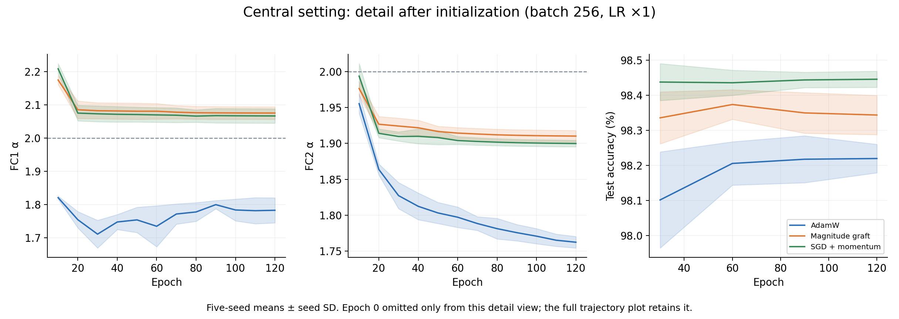
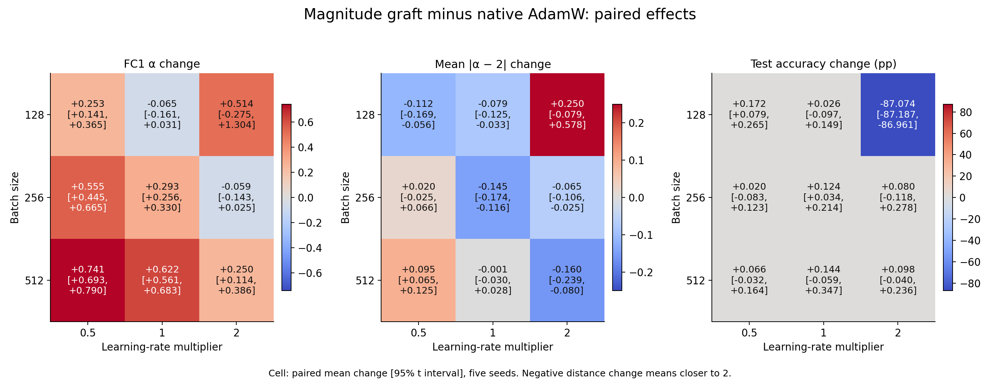

# Experiment 01: MNIST magnitude-only AdamW graft

**Complete and verified: 135/135 runs, five paired seeds, 120 epochs each.** Training finished on 2026-11-14. All 675 scheduled checkpoints are preserved. No next experiment is running.

The modification improves accuracy and moves the hidden-layer exponents closer to 2 at the prespecified central setting. Its behavior depends on the setting: at batch 128 / LR ×2, all five graft runs collapse to constant predictions. All outcomes remain in the analysis.

## Prespecified central setting: batch 256, LR ×1

Values are five-seed means. The full [results report](RESULTS.md) includes seed SDs, confidence intervals, every setting, and all three layer exponents.

| Optimizer | FC1 α | FC2 α | Mean hidden \|α−2\| | Test accuracy |
|---|---:|---:|---:|---:|
| Native AdamW | 1.783 | 1.762 | 0.228 | 98.220% |
| Magnitude graft | 2.075 | 1.910 | 0.083 | 98.344% |
| SGD + momentum | 2.067 | 1.900 | 0.083 | 98.446% |

Graft minus AdamW: accuracy **+0.124 percentage points [0.034, 0.214]**; mean absolute distance to 2 **−0.145 [−0.174, −0.116]**. Brackets are paired 95% Student t intervals over five seeds.

## Full grid: upward movement is distinct from improvement

Averaging the nine preset settings within each seed, the graft raises FC1 α by **0.345 [0.269, 0.421]** and FC2 α by **0.127 [0.099, 0.154]**. Its mean distance change is **−0.022 [−0.075, 0.031]**, which does not resolve an overall movement closer to 2. The five collapsed runs lower its grid-average accuracy by **9.594 percentage points [9.498, 9.689]** relative to AdamW. SGDM's grid-average accuracy is **0.103 points [0.069, 0.137]** higher than AdamW's, while its average distance change is unresolved.

The collapsed graft runs score 11.35%. Restoring their checkpoints shows that FC2 is zero for every test example and the network predicts digit 1 throughout. All final recorded matrix-gradient norms are zero. [Diagnostic evidence](verification/Low_Accuracy_Diagnostics.json). Some collapsed checkpoints nevertheless have α near 2; spectral proximity alone does not guarantee useful predictions.

## Plots and numerical evidence

- [Hidden-layer α: all settings and seeds](plots/Layer_Alpha_All_Settings.png)
- [Accuracy versus mean α: full range and labeled detail](plots/Accuracy_vs_Alpha_Detail.png)
- [Accuracy versus mean α: original full-range plot](plots/Accuracy_vs_Alpha.png)
- [Paired effects with the SGDM control](plots/Paired_Effects_With_SGDM.png)
- [Central-setting full trajectories, including initialization](plots/Central_Setting_Trajectories.png)
- [FC3 α: exploratory, only ten eigenvalues](plots/Head_Alpha_Exploratory.png)

[All 135 endpoints](results/endpoints.csv) · [All layer measurements](results/all_layer_measurements.csv) · [Paired confidence intervals](results/paired_summaries.csv) · [Trajectories](results/trajectories.csv) · [Machine-readable result summary](results/Experiment01_Result_Summary.json) · [Saved checkpoints and raw data](ARTIFACTS.md).

## Frozen design

MNIST; ReLU MLP 784→256→256→10; seeds 31001–31005; batches 128/256/512; LR multipliers 0.5/1/2; native AdamW, magnitude graft, and SGDM. Adam peak layer rates are [0.001, 0.001, 0.001]; SGDM target rates are [0.04, 0.2, 0.8]. All arms have matched decay per processed example. The [protocol](frozen/Protocol.json) specifies the split, schedule, evaluation times, fit rules, and complete grid.

For Adam's matrix update A and first moment m, with β₁=0.9, the graft applies `D = ||−η_S m/(1−β₁)||_F A/||A||_F`. Adam direction, moments, bias corrections, and bias updates are retained. The SGDM magnitude uses that graft run's own gradient history. The frozen implementation regularizes the norm denominator at 10⁻³⁰; tiny-update exceptions are explicitly recorded in verification.

WeightWatcher 0.7.7 uses its default tail selection, without an α-targeted cutoff. Primary means and distances use FC1 and FC2. FC3 is exploratory because it has ten eigenvalues. Of 270 final hidden-layer fits, 268 meet the prespecified support rule. The five seeds are replicates; the nine settings are not independent seeds. Overall intervals first average the nine paired differences within each seed, then use five seed averages; intervals are descriptive and not multiplicity-adjusted.

## Verification and provenance

[Full verification](verification/Final_Verification.json) confirms all 135 initial and final model hashes, all 675 checkpoint hashes, common initializations and per-epoch example order, and identical minibatches within each paired setting. Saved logits reproduce all accuracy counts. The 369,137 recorded nondegenerate graft magnitudes agree with the SGDM targets to a maximum relative error of 1.20×10⁻⁷. All 45 graft checkpoints were checked against native Adam moments and biases and the exact matrix reconstruction; four layer checks enter the existing denominator-floor regime.

Seven current-runtime runs replay eleven minibatches exactly from epoch 30. The 14 previously completed runs were restored with documented small cross-runtime replay differences; their raw spectra differ by at most 2.28×10⁻¹³ and their α estimates reproduce. These historical checks are numerical-tolerance checks, not claims of bitwise identity.

Training source SHA256: `1bfd7032e00ad87d729670197925fb40e19bc802a8eb716db2571e56b538d3d8`. The source and protocol remain frozen. This continuation reused 14 completed runs and trained the remaining 121; cumulative recorded training wall time, including prior segments, was 80.5 minutes. The interrupted earlier attempts and the runtime restoration are documented in the execution records. [Reanalysis instructions](execution/README.md).

This pass establishes setting-dependent effects of the magnitude intervention. It does not by itself establish an RG Jacobian condition. Stop for review before any further experiment.

## Fresh-seed replication: batch 128, LR ×2

The separately authorized [seed-31006 replication](replications/2026-11-14_batch128_seed31006/README.md) completed all three paired 120-epoch runs. Test accuracy was AdamW **98.52%**, magnitude graft **11.35%**, and SGDM **98.01%**. The graft again has zero FC2 activations on every test image and predicts digit 1 throughout. Collapse has therefore occurred in all six tested seeds at this setting; the lower-rate batch-128 settings did not collapse. The original 135-run tables and five-seed intervals above remain unchanged. Replication plots, endpoints, saved checkpoints and verification are linked in its separate folder.

