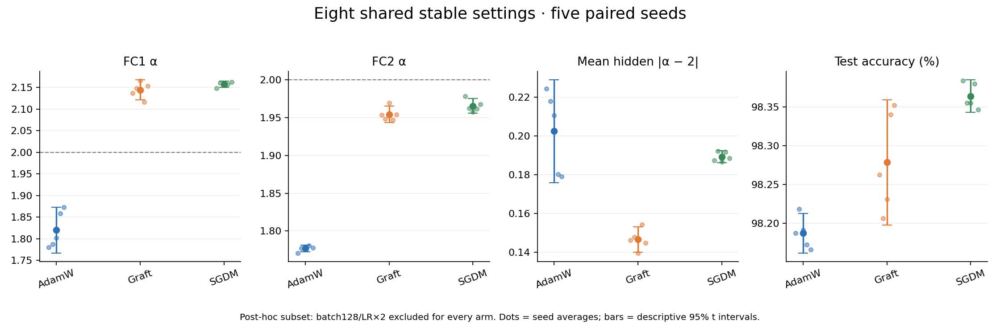
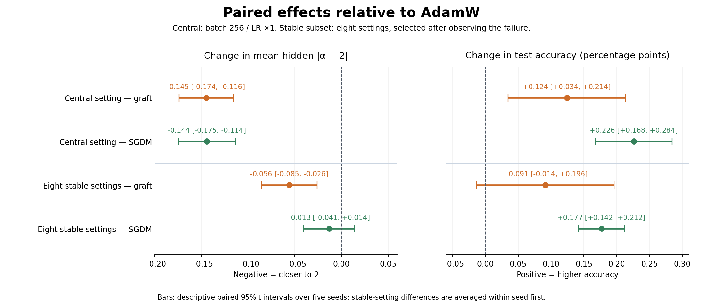

# Experiment 01: stable-setting comparison

**120 original runs: eight shared settings × five paired seeds × three optimizers.**

This is a post-hoc stable-setting analysis requested after the batch128/LR×2 graft failures were observed. It is conditional on the eight settings where all arms trained successfully; it does not replace the prespecified full-grid analysis. Exclude the entire failing setting from this comparison, including its successful controls, to retain identical settings and seeds across arms. Do not filter on α or on which optimizer wins.

Included settings: batch128 at LR×0.5/×1; batch256 and batch512 at LR×0.5/×1/×2. All 240 hidden-layer fits in this subset satisfy the original fit-support rule. FC3 has only ten eigenvalues and remains exploratory.

## Means over stable settings

Entries are mean [95% Student t interval]. Average eight settings within each seed first; then use the five independent seed averages. These descriptive intervals do not account for post-hoc setting selection or multiplicity.

| Optimizer | FC1 α | FC2 α | Mean hidden \|α−2\| | Test accuracy (%) |
|---|---:|---:|---:|---:|
| AdamW | 1.820 [1.767, 1.873] | 1.777 [1.772, 1.782] | 0.202 [0.176, 0.229] | 98.187 [98.162, 98.213] |
| Magnitude graft | 2.144 [2.121, 2.167] | 1.954 [1.943, 1.966] | 0.147 [0.140, 0.153] | 98.278 [98.198, 98.359] |
| SGD + momentum | 2.157 [2.150, 2.164] | 1.966 [1.956, 1.975] | 0.189 [0.186, 0.192] | 98.364 [98.343, 98.385] |

## Paired effects

Positive Δα is upward movement; negative Δ|α−2| is movement closer to 2; positive Δaccuracy is higher accuracy. These are distinct outcomes.

| Treatment − reference | ΔFC1 α | ΔFC2 α | Δmean \|α−2\| | Δaccuracy (pp) |
|---|---:|---:|---:|---:|
| Magnitude graft − AdamW | +0.324 [+0.261, +0.387] | +0.177 [+0.165, +0.190] | -0.056 [-0.085, -0.026] | +0.091 [-0.014, +0.196] |
| SGD + momentum − AdamW | +0.337 [+0.288, +0.387] | +0.189 [+0.175, +0.202] | -0.013 [-0.041, +0.014] | +0.177 [+0.142, +0.212] |
| Magnitude graft − SGD + momentum | -0.013 [-0.035, +0.009] | -0.011 [-0.028, +0.006] | -0.043 [-0.047, -0.038] | -0.085 [-0.167, -0.004] |

## Every included setting

Five-seed mean test accuracy; settings are retained regardless of treatment benefit.

| Batch | LR multiplier | AdamW | Graft | SGDM |
|---:|---:|---:|---:|---:|
| 128 | 0.5 | 98.186% | 98.358% | 98.514% |
| 128 | 1 | 98.384% | 98.410% | 98.468% |
| 256 | 0.5 | 98.094% | 98.114% | 98.256% |
| 256 | 1 | 98.220% | 98.344% | 98.446% |
| 256 | 2 | 98.382% | 98.462% | 98.474% |
| 512 | 0.5 | 97.968% | 98.034% | 98.044% |
| 512 | 1 | 98.032% | 98.176% | 98.246% |
| 512 | 2 | 98.232% | 98.330% | 98.464% |

## Central-setting and stable-setting effects

The central setting is prespecified. The eight-setting subset is post hoc. [Model status and concise summary](MODEL_STATUS.md) separates usable classifiers from failed hyperparameter settings; [plot data](results/status_review_paired_effects.csv) reproduce the saved paired intervals.

## Interpretation and preserved evidence

The prespecified central setting remains batch256/LR×1, with its original five-seed estimates. Stable training does not establish optimal tuning: AdamW shows increasing late validation cross-entropy despite strong accuracy. Future rate selection should use validation behavior, with α retained as an outcome.

[Hyperparameter failures](HYPERPARAMETER_FAILURES.md) · [Original full-grid results](FULL_GRID_RESULTS.md) · [Original full-grid narrative](FULL_GRID_ANALYSIS.md) · [All run dispositions](results/run_disposition.csv) · [Stable endpoints](results/stable_endpoints.csv) · [Paired effects](results/stable_paired_effects.csv) · [Checkpoints and raw data](ARTIFACTS.md)
