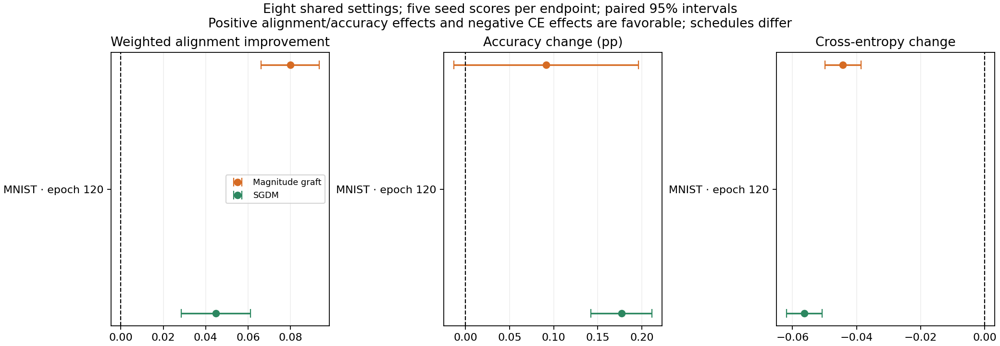
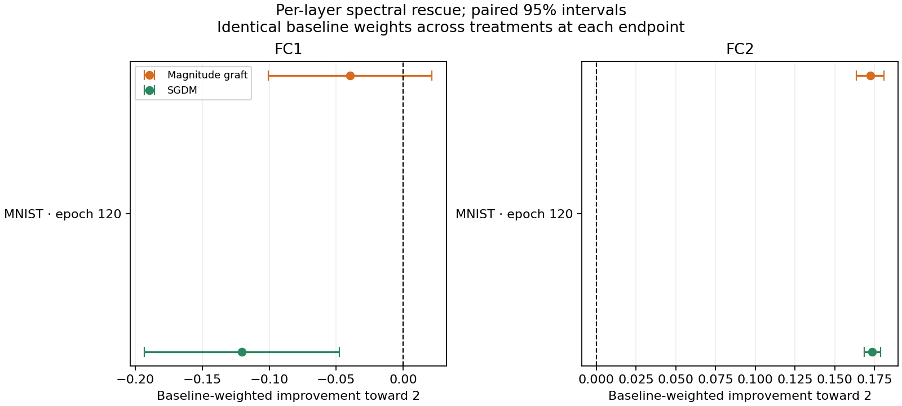

# MNIST: weighted spectral rescue

Reproducible analysis of saved endpoints only. No new training or changed primary results.

## Metric and inference

For each matched layer, dA=|alpha_AdamW−2| and dT=|alpha_treatment−2|. The primary weight is w=dA. Within each seed, I=sum[w(dA−dT)]/sum[w]. Positive I means rescue toward 2. Baseline weights are identical across treatments. Combined scores sum both layers before normalization, rather than averaging separately normalized layer scores. Five seed scores are averaged equally; intervals use Student-t with 4 degrees of freedom. Model accuracy and CE contrasts remain ordinary paired seed means over settings, not severity-weighted performance claims.

The separately labeled sensitivity uses w=max(0,2−alpha_AdamW); treatment distance remains absolute so overshoot is penalized. Both weightings, both treatments and all settings are retained. No weighting exponent was tuned. Zero total weight or nonfinite scores remain undefined, never silently dropped. FC3 alpha is excluded because its fit has only 10 eigenvalues; unsupported hidden fits are labeled and retained.

This weighting was chosen after seeing results. Intervals are descriptive, unadjusted for multiple comparisons, and conditional on fixed datasets/splits/settings. Baseline-derived weights may amplify estimation noise/regression to the mean. The five seeds, not settings or layers, are the replicates. Weights are recomputed from native AdamW separately at each endpoint; cross-epoch score changes are not fixed-weight longitudinal effects. Fashion 20 and 60 are the same models and test set, not independent replication. The comparison is descriptive because dataset and learning-rate schedule differ.

## Eight shared settings

All values are mean differences [paired 95% interval]. Positive weighted improvement/accuracy is favorable; negative CE is favorable.

| Endpoint | Treatment | Weighted FC1 improvement | Weighted FC2 improvement | Combined improvement | Accuracy change (pp) | CE change |
|---|---|---:|---:|---:|---:|---:|
| mnist_e120 | Magnitude graft | -0.03958 [-0.10082, +0.02166] | +0.17236 [+0.16378, +0.18093] | +0.07998 [+0.06628, +0.09369] | +0.09125 [-0.01355, +0.19605] | -0.04425 [-0.04989, -0.03862] |
| mnist_e120 | SGDM | -0.12035 [-0.19311, -0.04760] | +0.17356 [+0.16842, +0.17870] | +0.04490 [+0.02860, +0.06119] | +0.17675 [+0.14193, +0.21157] | -0.05631 [-0.06189, -0.05072] |

## Status and scope

- mnist_e120: 135 original endpoint rows; status counts {'USABLE': 130, 'FAILED': 5}; schedule: 5-epoch warmup; cosine to 10% peak at 120.

The original MNIST grid has 135 runs. Its batch 128/LR×2 graft failed in all five original seeds; the separate seed 31006 replication contains one further failed graft and two usable controls. The entire 138-model status register is preserved. The common eight-setting comparison contains 120 usable models, and is conditional on the previously identified stable settings. The fifteen original outcomes at the excluded setting are retained below and in `campaign_results/models.csv`; none were erased. Two original collapsed models also have unsupported hidden fits.

## Full original nine-setting sensitivity

These scores include all 135 original models, including collapsed classifiers. A numerically favorable alpha score does not make a collapsed classifier usable. Do not substitute this spectral-only statistic for the functional failure register. The incomplete sixth-seed replication is never added to the five-seed intervals.

| Endpoint | Treatment | Weighted FC1 improvement | Weighted FC2 improvement | Combined improvement | Accuracy change (pp) | CE change |
|---|---|---:|---:|---:|---:|---:|
| mnist_e120 | Magnitude graft | -0.07343 [-0.19872, +0.05185] | +0.16945 [+0.15910, +0.17981] | +0.05595 [+0.00298, +0.10891] | -9.59378 [-9.68917, -9.49838] | +0.19354 [+0.18846, +0.19862] |
| mnist_e120 | SGDM | -0.10903 [-0.16626, -0.05180] | +0.17130 [+0.16663, +0.17598] | +0.03874 [+0.02285, +0.05464] | +0.10333 [+0.06931, +0.13735] | -0.03248 [-0.04120, -0.02377] |

## Reproduce and inspect

Run `python reproduce.py` from this folder. This invokes the shared code and regenerates this dataset’s campaign outputs. Original source inputs and earlier reports are read-only.

[General comparison](../../../comparisons/README.md) · [Reusable analysis code](../../../comparisons/analysis/build.py) · [Source hashes](../../../comparisons/sources.lock.json) · [Numerical verification](campaign_results/Verification.json) · [All derived tables](campaign_results/).
