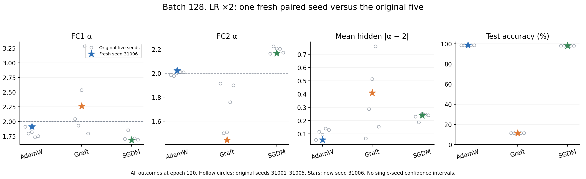
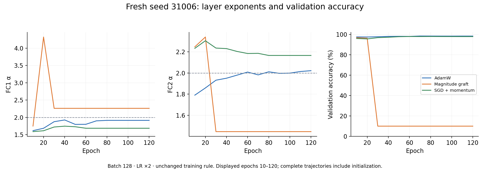

# Batch-128 replication: fresh seed 31006

**Complete and verified: three paired runs, 120 epochs each.** Only the seed changed from the failing batch128 / LR×2 condition. Native AdamW and SGDM remain the controls.

The fresh seed reproduces the low-accuracy graft outcome. Together with the original five seeds, this is 6/6 tested seeds with collapse at batch 128 / LR ×2.

| Optimizer | FC1 α | FC2 α | Mean hidden \|α−2\| | Test accuracy |
|---|---:|---:|---:|---:|
| AdamW | 1.914 | 2.022 | 0.054 | 98.52% |
| Magnitude graft | 2.262 | 1.445 | 0.408 | 11.35% |
| SGD + momentum | 1.687 | 2.166 | 0.240 | 98.01% |

This is one additional paired seed, so no confidence interval is assigned to these three new outcomes. The original five-seed primary analysis is unchanged. The original batch-128 runs at lower learning rates did not collapse; this replication targets the batch128 / LR×2 combination.

## Checkpoint diagnostics

In the graft checkpoint, the fraction of test examples with an all-zero FC2 vector is 1.000; the maximum per-class logit range across test inputs is 0. Prediction counts are [0, 10000, 0, 0, 0, 0, 0, 0, 0, 0]. These are direct measurements from the saved model, with no retraining.

## Protocol and verification

MNIST; ReLU MLP 784→256→256→10; batch128; LR multiplier2; seed31006; 120 epochs. The new seed changes initialization and minibatch order together, shared across arms. The data split, schedule, matched decay, layer rates, and magnitude-only graft remain unchanged. Adam direction, moments, and bias updates are retained; the target magnitude uses the graft’s own gradient history.

Frozen training source SHA256: `1bfd7032e00ad87d729670197925fb40e19bc802a8eb716db2571e56b538d3d8`.

All 15 checkpoints are hashed. All three initial/final hashes, saved spectra, alpha estimates, saved test-accuracy counts, and eleven-step checkpoint replays pass. 3722 recorded nondegenerate graft magnitudes were checked, with maximum relative error 1.19e-07. The existing denominator floor is handled explicitly in the graft check. Training wall time was 4.35 minutes.

A separate replay from initialization checks all three nonzero matrix updates: Adam direction, moments and bias updates are preserved, and magnitudes match their SGDM targets. The epoch-30 replay also checks the collapsed, zero-update regime; direction is undefined there.

[Verification details](verification/Replication_Verification.json) · [Protocol](protocol/Replication_Protocol.json) · [Endpoints](results/Endpoints.csv) · [Paired differences](results/Paired_Differences.csv) · [Saved states and raw data](ARTIFACTS.md).

FC3 fits are exploratory because the output matrix has only ten eigenvalues. The primary means and distances use FC1 and FC2. No additional settings or datasets were trained.

To reproduce the analysis, extract the complete archive, match the package versions in the protocol, and run `python analyze_replication.py` from its root. That command reads and replays saved states without continuing training. Do not invoke the training source’s historical default sweep. The completed replication does not authorize another run.
