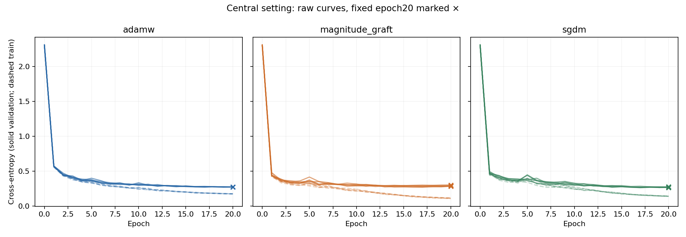
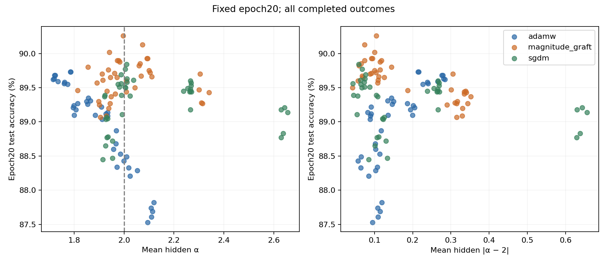

# Clean fixed-endpoint Fashion-MNIST restart

120/120 completed and verified. All earlier outcomes remain separate.

All primary endpoints are epoch20. Five-epoch warmup followed by cosine annealing over15epochs to10% of peak rate. Same architecture, frozen optimizer kernel, layer rates, five paired seeds, data split and minibatches. Validation and WeightWatcher evaluated every epoch; no loss-based or alpha-based checkpoint selection. Separate central-setting pilot seed31999 excluded from inference. Test evaluated once per final checkpoint. The test set was used in earlier experiments, so this is not a previously unseen test set.

[Model register](results/model_status.csv) · [Final endpoints](results/endpoints.csv) · [Layer fits](results/layer_measurements.csv) · [Paired effects](results/paired_effects.csv) · [Raw loss curves](results/raw_loss_trajectories.csv)

Five seeds are independent; eight settings are averaged within seed for overall paired95%t intervals. All outcomes and unsupported fits are retained. FC3 has only10eigenvalues and is exploratory/unsupported. Functional quality requires validation accuracy>=80% with nonconstant predictions; alpha is separate. Upward alpha, smaller|alpha−2|, greater accuracy and lower cross-entropy are distinct outcomes. These descriptive paired intervals are unadjusted across multiple metrics/settings; no accuracy improvement when an interval includes0.

