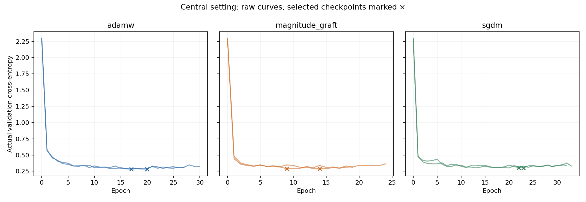
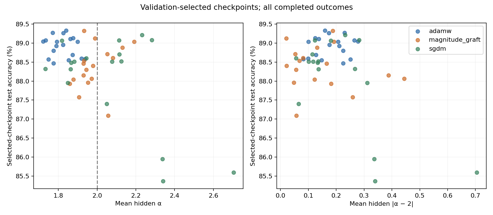

# Validation-stopped Fashion-MNIST rerun

52/120 completed and verified. Original fixed120-epoch outcomes remain separate.

Same architecture, optimizer kernels, layer rates, five seeds, data split and minibatches. Validation evaluated every epoch; restore minimum validation cross-entropy checkpoint; stop after10epochs without improvement, minimum10 and maximum120epochs. Raw validation loss may fluctuate and is never rewritten as a monotonic curve. Neither test accuracy nor alpha selects checkpoints.

[Model register](results/model_status.csv) · [Selected endpoints](results/endpoints.csv) · [Layer fits](results/layer_measurements.csv) · [Paired effects](results/paired_effects.csv) · [Raw loss curves](results/raw_loss_trajectories.csv)

Five seeds are independent; eight settings are averaged within seed for overall paired95%t intervals. Pilot central cases count once in120. Failures and unsupported fits are retained. Lower |alpha−2|, upward alpha movement, accuracy and cross-entropy are distinct outcomes.

**Incomplete: no full five-seed conclusion is claimed.**

