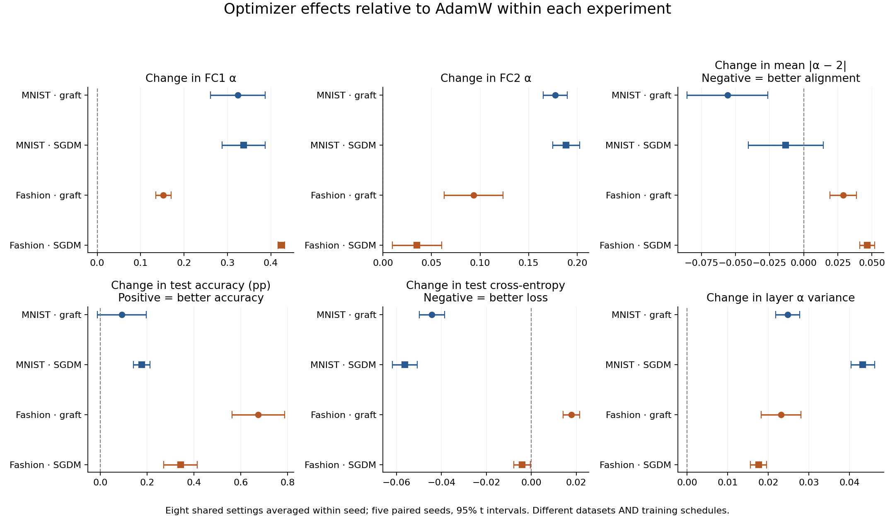
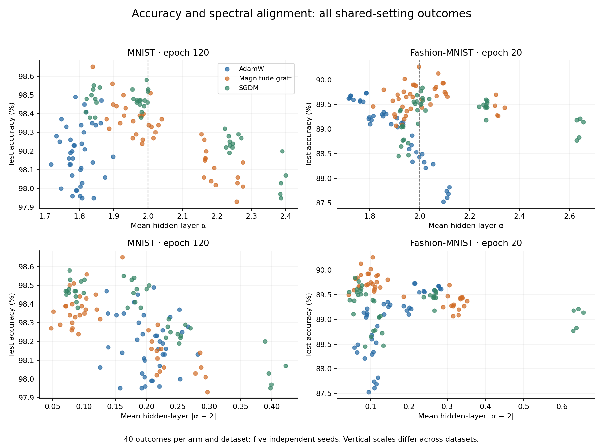
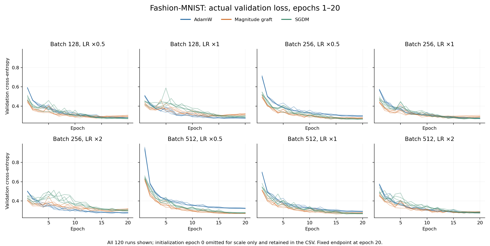

# Comparison with the original MNIST experiment

The graft raises hidden-layer alpha on average in both experiments. Its effect on alignment and predictive performance differs. In the eight shared MNIST settings it improves mean absolute distance from 2 and lowers test cross-entropy, but the accuracy interval includes zero. In Fashion-MNIST it improves test accuracy while increasing mean absolute distance from 2 and test cross-entropy.

This is a descriptive comparison of existing experiments. Dataset **and training schedule** differ: MNIST used120 epochs with cosine annealing over120 epochs; the completed Fashion pass used20 epochs with cosine annealing over20 epochs. It cannot isolate the effect of changing only the dataset. No new training, checkpoint selection or alpha-based filtering was used for this comparison.

## Common settings and endpoints

The comparison uses batch 128 LR ×0.5/1, batch256 LR ×0.5/1/2 and batch512 LR ×0.5/1/2. Each experiment contributes 120 outcomes: five seeds 31001–31005 × eight settings × three arms. Both use784→256→256→10 ReLU MLPs, the same original optimizer kernel and exact magnitude-only graft. Peak layer rates, momentum and common decay match; the schedule horizon does not. Graft directions/moments/bias updates remain Adam, and its matrix update magnitude comes from SGDM history on that run's own gradients.

The table averages every included per-model measurement. In particular, mean|alpha−2| is computed **before averaging across models**; it is not |mean(alpha)−2|.

| Dataset | Arm | FC1 α | FC2 α | Mean hidden \|α−2\| | Test accuracy | Test CE |
|---|---|---:|---:|---:|---:|---:|
| MNIST | AdamW | 1.820 | 1.777 | 0.202 | 98.187% | 0.1417 |
| MNIST | Magnitude graft | 2.144 | 1.954 | 0.147 | 98.278% | 0.0975 |
| MNIST | SGDM | 2.157 | 1.966 | 0.189 | 98.364% | 0.0854 |
| Fashion-MNIST | AdamW | 1.791 | 2.005 | 0.153 | 88.936% | 0.3221 |
| Fashion-MNIST | Magnitude graft | 1.944 | 2.098 | 0.182 | 89.611% | 0.3399 |
| Fashion-MNIST | SGDM | 2.215 | 2.040 | 0.199 | 89.279% | 0.3180 |

## Paired effects relative to AdamW

Values are mean differences [95% Student t intervals]. For each seed, first average the eight settings; then use five paired seed differences (df4). The settings are not independent replicates. These intervals reflect training-seed variability conditional on these fixed datasets, splits and settings; they are unadjusted for multiple metrics/settings and do not include dataset-resampling uncertainty.

| Dataset | Treatment | Δ FC1 α | Δ FC2 α | Δ mean hidden \|α−2\| | Δ accuracy (pp) | Δ test CE |
|---|---|---:|---:|---:|---:|---:|
| MNIST | Magnitude graft | 0.324 [0.261, 0.387] | 0.177 [0.165, 0.190] | -0.056 [-0.085, -0.026] | 0.091 [-0.014, 0.196] | -0.044 [-0.050, -0.039] |
| MNIST | SGDM | 0.337 [0.288, 0.387] | 0.189 [0.175, 0.202] | -0.013 [-0.041, 0.014] | 0.177 [0.142, 0.212] | -0.056 [-0.062, -0.051] |
| Fashion-MNIST | Magnitude graft | 0.152 [0.135, 0.170] | 0.093 [0.063, 0.124] | 0.029 [0.019, 0.039] | 0.675 [0.563, 0.786] | 0.018 [0.014, 0.021] |
| Fashion-MNIST | SGDM | 0.424 [0.416, 0.431] | 0.035 [0.010, 0.061] | 0.046 [0.041, 0.052] | 0.343 [0.271, 0.414] | -0.004 [-0.008, -0.000] |

Positive Δalpha means upward movement. Negative Δdistance means closer to2. Positive Δaccuracy and negative ΔCE are better predictive outcomes. None of these implications should be substituted for another. The aggregate differences also vary by setting; all per-setting contrasts are in [paired effects](comparison/paired_effects_with_95ci.csv).

## Failures and fit support

- MNIST original: 135 runs. The five graft runs at batch 128/LR ×2 collapsed to 11.35% accuracy. That setting was omitted from the Fashion protocol before this clean pass, so its 15 original outcomes are outside the shared-grid comparison; they remain in [all original MNIST outcomes](comparison/mnist_all_original_outcomes.csv). No individual seed or optimizer outcome was dropped within the eight common settings.
- MNIST replication: three seed 31006 runs, including one reproduced graft collapse. These are retained in the [138-model original-plus-replication register](comparison/mnist_original_and_replication_status.csv), but are not a sixth balanced seed and are excluded from this paired analysis.
- Fashion clean pass:120/120complete, all 120 met the predefined functional threshold of validation accuracy ≥ 80% with nonconstant predictions. This is not a claim of optimal hyperparameters. All 240 hidden-layer fits met the predefined support rule. FC3 has only10 eigenvalues and remains unsupported/exploratory; its values are retained in the numerical tables and excluded from hidden-layer averages.
- Earlier interrupted and validation-stopped Fashion outcomes are preserved at their original paths and are not pooled into this analysis.

The MNIST stable-grid results were originally selected after observing the failed setting; the shared-grid comparison inherits that limitation. The same test datasets were examined in earlier work, so this is not an untouched external-validation exercise. These observations do not establish an RG Jacobian condition or a universal optimizer advantage.

## Plots

## Reproduction and evidence

Run `python analysis/compare.py` from this folder with NumPy, pandas, SciPy and Matplotlib installed. It reads the pinned input snapshots, recomputes all summaries/paired intervals, writes the CSVs and produces the figures. It verifies agreement with the already-published MNIST and Fashion statistics to numerical precision. [Comparison verification](comparison/Comparison_Verification.json) records the maximum discrepancy. Raw Fashion curves including epoch0 remain in [the complete trajectory CSV](results/raw_loss_trajectories.csv).

[Source manifest](verification/Publication_Source_Manifest.json) identifies the exact original Git blobs and commit. [Saved numerical artifacts and checkpoints](ARTIFACTS.md) include receipts and SHA256 hashes. Original MNIST files, frozen training source and all preceding Fashion outcomes are unchanged.
