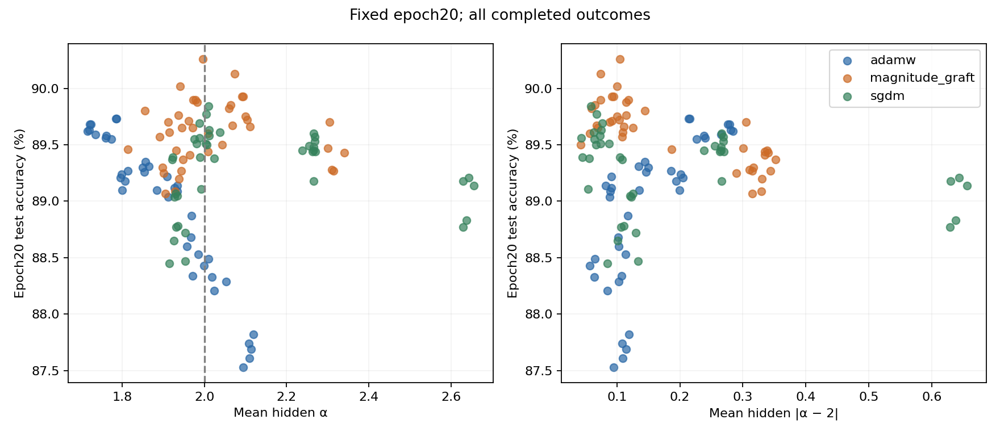

# Fashion-MNIST Experiment02: completed fixed-endpoint pass

## Results at a glance

This experiment contributes 120 epoch-20 Fashion checkpoints. At this endpoint, the best modified AdamW checkpoint reached 90.26% test accuracy at average α = 2.0023. The epoch-60 extension tied on accuracy, and epoch 20 was closer to 2.

[Results and code](../comparisons/rg_paper/README.md) · [Tiếng Việt](../comparisons/rg_paper/RESULTS.vi.md) · [Numbers (JSON)](../comparisons/rg_paper/results.json)

**Complete:120/120 runs, five paired seeds, eight settings, three optimizers. All runs use epoch 20.** This is the completed-results folder, parallel to the original MNIST Experiment01 folder. It publishes the verified clean pass; it is not a new training launch.

- [Results and MNIST comparison](COMPARISON.md)
- [All 120 model statuses](results/model_status.csv), [endpoints](results/endpoints.csv), [per-layer measurements](results/layer_measurements.csv), [paired 95% intervals](results/paired_effects.csv)
- [Comparison plots](plots/), [original plots](original_plots/), [raw training/validation curves](results/raw_loss_trajectories.csv)
- [Verification](results/Verification.json), [frozen protocol](frozen/Protocol.json), [pilot gate](verification/Pilot_Gate.json)
- [Saved checkpoints and bundles](ARTIFACTS.md)

The magnitude graft increased Fashion-MNIST accuracy by 0.675 percentage points (paired 95% CI[0.563,0.786]) relative to AdamW. Both hidden-layer alphas rose, but mean absolute distance from 2 increased by 0.029[0.019,0.039]; test cross-entropy also increased. Accuracy improvement therefore does not establish improved spectral alignment.

The five seed replicates, shared initialization/minibatches, exact checkpoint replay, restored spectra/validation, data/source hashes and nonzero graft checks all passed. The 3 pilot runs at seed 31999 are excluded from inference. Alpha never selected a checkpoint or gated training. All failures and unsupported fits remain visible. FC3 has only10 eigenvalues and is not used for hidden-layer inference.

MNIST used120 epochs; this Fashion pass used20 epochs with a shorter annealing schedule. The comparison is descriptive and cannot isolate dataset effects. The old batch 128/LR ×2MNIST collapse remains documented separately; no outcomes were erased.

[Original execution source and history](../2026-11-15_fashion_mnist_mlp_experiment02/follow_up/2026-11-15_clean_fixed_endpoint/) · [Successful workflow](https://github.com/CalculatedContent/rg_optimizers/actions/runs/43711325491) · [Original results commit](https://github.com/CalculatedContent/rg_optimizers/commit/3f122d1df1de462f73d276aa16eedef17ba244de)

Training is finished. GPT remains on hold; no further experiments were launched during publication.
