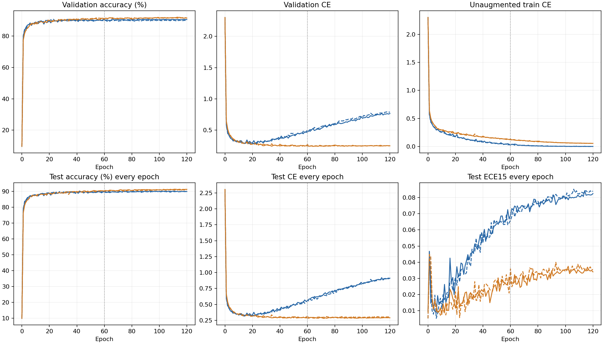

# Native AdamW: paired120-epoch diagnostic

## Results at a glance

The 2 unaugmented Fashion AdamW runs retained average test accuracy near 89.8% between epochs 60 and 120. The hardest 10% of images accounted for 91.26% of the increase in test log loss. The paper replay includes the per-image predictions for this comparison.

[Results and code](../comparisons/rg_paper/README.md) · [Tiếng Việt](../comparisons/rg_paper/RESULTS.vi.md) · [Numbers (JSON)](../comparisons/rg_paper/results.json)

Latest user correction fixes the horizon at120epochs and requires data and plots for everyepoch. This supersedes the unlaunched1000-epoch draft.

Four trajectories: two paired seeds33001/33002, each with augmentation off/on. Fashion-MNIST784→256→256→10 ReLU, B256, native AdamW only. Same initialization, split, order, learning rates, sample-normalized decoupled decay and25800updates per completed model. Five-epoch warmup to0.001, then cosine to0.0001 at120. Only augmentation differs: historical50%zero-padded translations up to2pixels on training images. Validation/test images remain unchanged.

Every epoch0–120: save model, optimizer and RNG; full training/validation CE and accuracy; raw spectra, all layer alpha estimates and fit support; layer norms and step accounting. Every training minibatch: record loss and gradient/moment/update statistics. After each complete120-epoch trajectory, evaluate its121prespecified saved checkpoints on the test set and retain logits, accuracy, CE, ECE and Brier. Test results never feed back into training or endpoint selection.

Plot complete alpha, distance-to2, sub2deficit, learning rate, train/validation/test performance and calibration curves. Report both seeds individually, paired augmentation differences, and20→60→120changes. Two seeds remain exploratory. FC3's ten correlated eigenvalues remain exploratory; save native and direct smallN estimates separately. Crossing2 is not convergence to2;120epochs is not an asymptotic proof.

This workflow queues behind the active epoch60→120 continuation using its existing concurrency group; it neither cancels nor changes that experiment. Excluded2-epoch smoke runs verify exact replay, negative controls, native AdamW, augmentation and pairing. No alpha or accuracy gate selects results. Four-hour preflight/training cap, five-hourjob cap; no automatic extension/retry. Source freezes at launch. Results, code, plots and every failure stay in this separate folder; checkpoints are preserved in artifacts for90days and backed up by the monitor.
