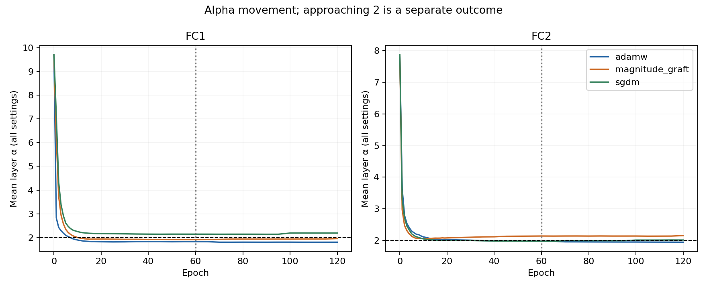

# Fashion-MNIST: same unaugmented models, epoch60 to120

## Results at a glance

This continuation preserved 49 completed epoch-120 endpoints. For the 2 central seeds with all optimizers present, average α moved from 1.867 to 2.067 after the correction, compared with 2.016 for momentum SGD.

[Results and code](../comparisons/rg_paper/README.md) · [Tiếng Việt](../comparisons/rg_paper/RESULTS.vi.md) · [Numbers (JSON)](../comparisons/rg_paper/results.json)

Charles authorized continuation of the original120 epoch60 models to epoch120 and asked that learning rate and optimizer-step counts be accounted for. This folder preserves the earlier experiments and their source unchanged.

## Fixed design

- Same Fashion-MNIST 784→256→256→10 ReLU MLP, original55000/5000/10000 split and pixels/255; **no augmentation**.
- All120 original specifications: seeds31001–31005, eight batch/LR settings, native AdamW, exact magnitude-only graft, SGDM. No new settings or seeds.
- Restore every epoch60 model, optimizer moments and RNG from completed run43793781330. Original initialization and absolute-epoch minibatch rule remain unchanged.
- Keep the actual epoch60 learning rate constant for epochs61–120: factor0.01 of original peak. At B256/LR1, Adam rates are0.00001 and SGDM matrix target rates are[0.0004,0.002,0.008]. Common explicit decay remains unchanged.
- Fixed primary endpoint120; validation every epoch, WeightWatcher every5. Checkpoints at source60,61,90,120 and rolling last. Test only fixed120; no early stopping or selection by alpha, validation or test.
- Exact graft preserves Adam matrix direction, first/second moments, bias correction and bias updates. Only matrix Frobenius magnitude uses SGDM history from that same trajectory.

## What this comparison answers

Within each saved model, compare epoch60 and120 under further low-rate training. At B256, updates rise from12900 to25800 and training examples processed rise from3.3million to6.6million. Because the rate is already small, cumulative nominal Adam LR rises from2.785325 to2.914325, only4.63%. Nominal LR sums are accounting quantities, not complete measures of adaptive effective update size; recorded gradient/update statistics are retained.

This does **not** match the augmented120epoch experiment's schedule. At epoch60 that experiment uses58.07% of peak versus1% here, as well as different seeds and augmentation. See [equal-epoch comparison](SCHEDULE_COMPARISON.md). An absent improvement here would not establish that longer training under another schedule cannot help.

## Verification and analysis

Before any new training, restore/hash-check all120 parents, verify hyperparameters and nonzero moments, compare saved epoch21→22 replay within the already declared numerical tolerances, and require exact replay from two independent restorations on the current runtime. Reject9 wrong batch/momentum/LR controls. Check15 resumed nonzero graft matrix updates against independent SGDM buffers and reference Adam. The three central continuations gate numerical correctness only and count once in120.

After training, require exact epoch61→62 replay, exact saved validation/spectral restoration, actual update counts, shared initial hashes/minibatch hashes and fixed endpoints. Preserve failures and unsupported fits. FC3 remains exploratory because it has10 eigenvalues; do not silently change historical estimators.

Report accuracy, CE, ECE/Brier, per-layer alpha, symmetric distance, one-sided deficit, capped/harmonic/parameter-weighted means and severity-weighted change. Average eight settings within each seed before paired95%t intervals over five independent seeds. Settings and layers are not independent replicates. Report all settings separately too; no complete inference if required endpoints are missing.

This follow-up was chosen after seeing earlier results, and the test set has been used before. It is exploratory. Higher alpha, closer to2, greater accuracy and lower CE are separate outcomes.

## Execution

One GitHub Actions workflow, maximum3workers, four-hour preflight/training cap and five-hour total workflow cap. No automatic retry, extension or retuning. Sources freeze at launch. Preflight failure stops expansion. Checkpoints and audits are uploaded for90days even if analysis fails; publication uses a clean worktree and a fresh main-head lease and only writes this folder's results/plots/report. GPT remains on hold.

Local source/step checks and24 parent metadata/120 checkpoint-file hashes passed. Numerical parent replay is required remotely before continuation; local runtime lacks PyTorch/WeightWatcher. Do not mistake local source checks for completed training or numerical verification.
