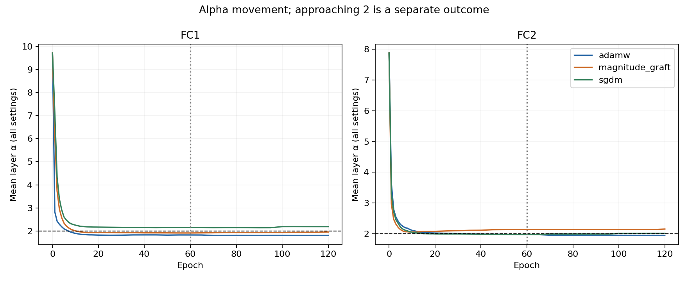
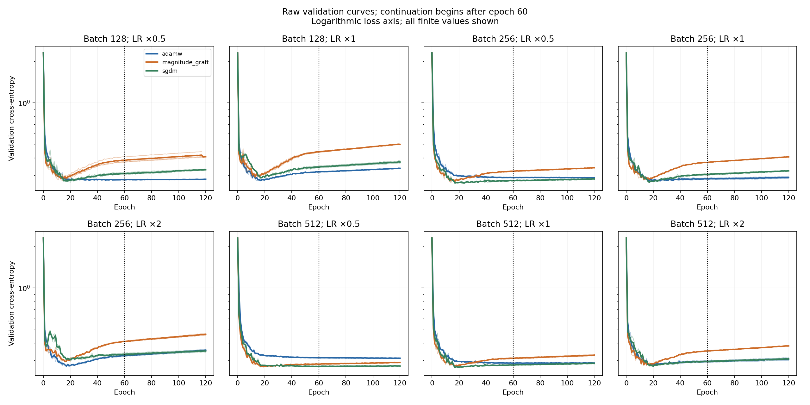

# Fashion-MNIST fixed continuation: epoch 60 → 120

> **Cancelled at Charles’s request on 16 November 2026.** Training stopped with49/120 fixed endpoints completed. The partial results, unfinished states and all five available seed archives were preserved; this is not a completed120-run pass. The separately authorized nativeAdamW paired120 experiment43864280628 has started. No restart of this continuation is authorized.

Completed: 49/120. Full verification passed: **False**.

Same120 unaugmented trajectories, restored from their exact epoch60 model/optimizer/RNG checkpoints. The continuation holds the actual terminal LR at1% of the original peak for epochs61-120. No warmup restart, augmentation, new seeds or retuning. Every endpoint is fixed before continuation. All outcomes and unsupported fits remain; FC3 is exploratory with10 eigenvalues.

This is an exploratory follow-up after seeing prior results, using the previously seen test set. Five seeds, not eight settings, are independent. Settings are averaged within each seed before paired95%t intervals. These are descriptive unadjusted intervals. The separate augmented120epoch cohort uses different seeds and a different schedule; it is not a controlled augmentation comparison.

At B256/LR1, epoch60 has12900 optimizer updates and epoch120 has25800. AdamW LR remains0.00001; SGDM matrix target rates remain[0.0004,0.002,0.008]. Other batches/multipliers retain their original settings. Full per-layer cumulative LR, squared LR, sample counts and explicit decay are in results/step_lr_accounting.csv. Cumulative LR does not fully describe adaptive effective steps.

[Parent epoch60 results](../2026-11-16_fashion_mnist_mlp_experiment02_extension_retry01/RESULTS.md) · [All model statuses](results/model_status.csv) · [Epoch60/120 endpoints](results/endpoints60_and120.csv) · [Paired effects](results/paired_effects.csv) · [Within-arm changes](results/within_arm_changes.csv) · [Effect changes](results/effect_changes.csv) · [Verification](results/Verification.json)

**Partial result: no complete five-seed inference is claimed.**

