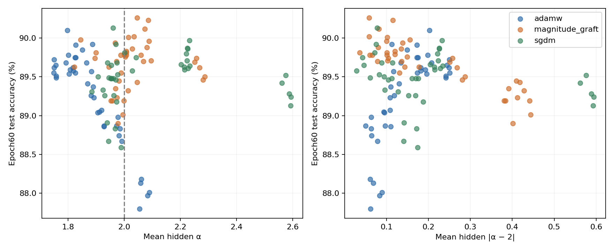
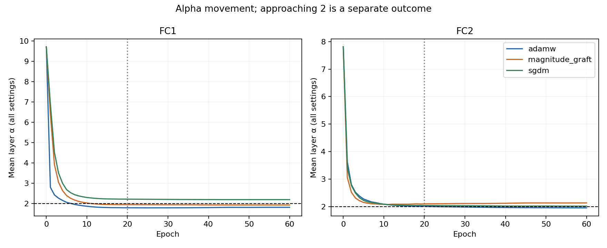
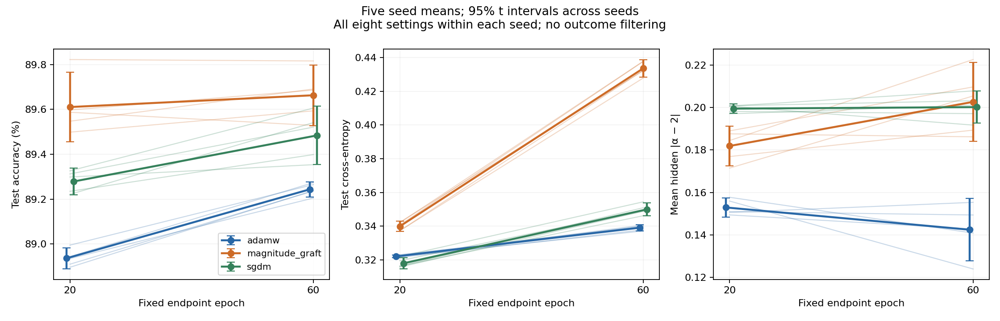
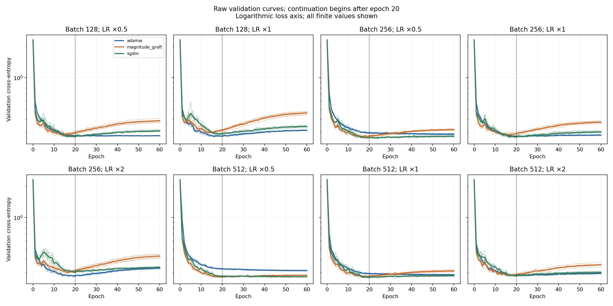

# Fashion-MNIST fixed continuation: epoch 20 → 60

Completed: 120/120. Full verification passed: **True**.

Retry01 follows the failed preflight attempt. Saved parent replay uses declared float32 tolerances with exact-match flags retained; checkpoint bytes/state and current-runtime replay remain exact. Nine incorrect input/state/rate controls must be rejected. See verification diagnostics and the protocol for bounds. This extension was chosen after observing mixed epoch20 results. It is an exploratory follow-up with its epoch60 endpoint fixed before continuation. Each model retains its own saved model, optimizer and RNG state. Five independent seeds; eight settings averaged within seed for overall paired 95% t intervals. No alpha, accuracy or validation-based endpoint selection. All outcomes and unsupported fits retained. FC3 is exploratory because it has only10 eigenvalues. The test set was observed previously.

Peak rates, architecture, data/split and exact magnitude-only graft are unchanged. Only the future schedule is new: cosine decay from10% of the original peak at20 to1% at60, without a warmup restart. This comparison tests a specified continuation, not a universal optimizer or RG claim.

[Parent epoch20 results](../2026-11-15_fashion_mnist_mlp_experiment02_clean/RESULTS.md) · [All model statuses](results/model_status.csv) · [Epoch20/60 endpoints](results/endpoints20_and60.csv) · [Paired effects](results/paired_effects.csv) · [Within-arm changes](results/within_arm_changes.csv) · [Effect changes](results/effect_changes.csv) · [Verification](results/Verification.json)

| Epoch | Arm | FC1 α | FC2 α | Mean hidden distance to2 | Test accuracy | Test CE |
|---|---|---:|---:|---:|---:|---:|
| 20 | adamw | 1.7914 | 2.0045 | 0.1530 | 88.936% | 0.3221 |
| 20 | magnitude_graft | 1.9438 | 2.0978 | 0.1819 | 89.611% | 0.3399 |
| 20 | sgdm | 2.2152 | 2.0397 | 0.1995 | 89.279% | 0.3180 |
| 60 | adamw | 1.8132 | 1.9536 | 0.1425 | 89.244% | 0.3391 |
| 60 | magnitude_graft | 1.9291 | 2.1330 | 0.2026 | 89.663% | 0.4336 |
| 60 | sgdm | 2.1919 | 2.0153 | 0.2002 | 89.484% | 0.3500 |

Graft − native AdamW at epoch60 (settings averaged within each seed):

| Metric | Mean difference | Paired 95% interval |
|---|---:|---:|
| alpha_fc1 | +0.11587 | [+0.07703, +0.15471] |
| alpha_fc2 | +0.17936 | [+0.16439, +0.19433] |
| alpha_fc3 | +0.19810 | [-0.02606, +0.42227] |
| distance_fc1 | +0.06632 | [+0.04263, +0.09002] |
| distance_fc2 | +0.05394 | [+0.02762, +0.08025] |
| distance_fc3 | +0.19810 | [-0.02606, +0.42227] |
| mean_alpha | +0.14762 | [+0.12807, +0.16716] |
| mean_abs_alpha_minus_2 | +0.06013 | [+0.03699, +0.08327] |
| alpha_layer_variance | +0.04645 | [+0.03943, +0.05346] |
| test_accuracy_pct | +0.41950 | [+0.27635, +0.56265] |
| test_loss | +0.09452 | [+0.08849, +0.10054] |
| validation_loss | +0.06648 | [+0.05833, +0.07464] |

Increasing α, decreasing |α−2|, increasing accuracy and decreasing CE are different outcomes. Positive accuracy differences favor graft; negative distance/CE differences favor graft. Intervals including0 do not establish improvement. CIs are descriptive and unadjusted for multiple comparisons. Functional quality is labeled separately from spectral alignment.

