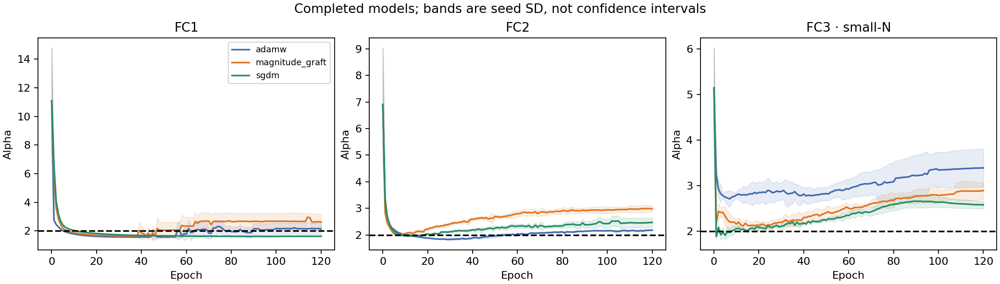
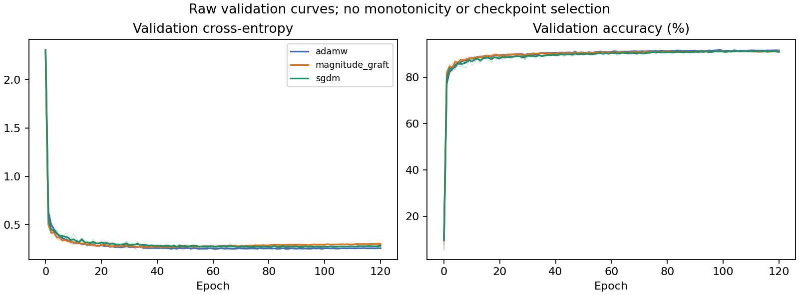

# Fashion-MNIST: audited magnitude graft with matched translation augmentation

Completed 15/15 fixed-epoch120 endpoints. Three pilot arms are excluded from inference. All model statuses are retained.

Same 784→256→256→10 MLP, five fresh paired seeds, batch256 and original rates. Training uses a shared 50% chance of a zero-padded translation up to two pixels. The schedule now matches the original MNIST 120-epoch schedule; augmentation and seeds also changed, so historical differences are not attributable to one factor.

Scale audit establishes conditional optimizer coordinate covariance. Grafted matrices have the SGDM target-rate scaling law; retained Adam biases have the Adam rate law. Full MLP loss invariance, a common SGDM law for every parameter, and RG trace-log preservation are not established.

FC3 uses WeightWatcher’s small-N routine directly with zero alpha prior; the native constructor estimate is also saved. Its ten eigenvalues remain a small correlated sample. Historical alpha estimates are unchanged.

## Paired treatment minus AdamW

Five seed-level differences; 95% Student-t intervals, df4. Missing endpoints produce undefined intervals. Positive accuracy is favorable; negative CE and sub-2 deficit are favorable. Alpha increases are separate from alignment.

| Arm | Metric | Mean | 95% interval |
|---|---|---:|---:|
| magnitude_graft | accuracy_pp | -0.34400 | [-0.56095, -0.12705] |
| magnitude_graft | ce | 0.06115 | [0.05681, 0.06550] |
| magnitude_graft | ece15 | 0.00798 | [0.00589, 0.01006] |
| magnitude_graft | brier | 0.00831 | [0.00613, 0.01049] |
| magnitude_graft | hidden_deficit | -0.02365 | [-0.17651, 0.12921] |
| magnitude_graft | all_layer_deficit | -0.01577 | [-0.11768, 0.08614] |
| magnitude_graft | hidden_distance | 0.59458 | [0.39875, 0.79042] |
| magnitude_graft | alpha_fc1 | 0.48011 | [-0.24065, 1.20088] |
| magnitude_graft | alpha_fc2 | 0.80367 | [0.64948, 0.95786] |
| magnitude_graft | alpha_fc3 | -0.49768 | [-1.16947, 0.17411] |
| magnitude_graft | distance_fc1 | 0.38550 | [0.09432, 0.67668] |
| magnitude_graft | distance_fc2 | 0.80367 | [0.64948, 0.95786] |
| magnitude_graft | distance_fc3 | -0.49768 | [-1.16947, 0.17411] |
| sgdm | accuracy_pp | -0.11600 | [-0.25936, 0.02736] |
| sgdm | ce | 0.02081 | [0.01199, 0.02963] |
| sgdm | ece15 | 0.00209 | [0.00044, 0.00373] |
| sgdm | brier | 0.00299 | [0.00064, 0.00535] |
| sgdm | hidden_deficit | 0.13550 | [0.03027, 0.24073] |
| sgdm | all_layer_deficit | 0.09033 | [0.02018, 0.16049] |
| sgdm | hidden_distance | 0.15743 | [0.03383, 0.28104] |
| sgdm | alpha_fc1 | -0.51632 | [-1.04101, 0.00838] |
| sgdm | alpha_fc2 | 0.28918 | [0.08647, 0.49189] |
| sgdm | alpha_fc3 | -0.80888 | [-1.31770, -0.30006] |
| sgdm | distance_fc1 | 0.02569 | [-0.22112, 0.27250] |
| sgdm | distance_fc2 | 0.28918 | [0.08647, 0.49189] |
| sgdm | distance_fc3 | -0.80888 | [-1.31770, -0.30006] |
| magnitude_graft | hidden_symmetric_weighted_rescue | -0.56236 | [-0.80242, -0.32229] |
| magnitude_graft | hidden_sub2_weighted_rescue | nan | [nan, nan] |
| magnitude_graft | all_layers_symmetric_weighted_rescue | 0.23050 | [-0.22647, 0.68748] |
| magnitude_graft | all_layers_sub2_weighted_rescue | nan | [nan, nan] |
| sgdm | hidden_symmetric_weighted_rescue | -0.09344 | [-0.25966, 0.07277] |
| sgdm | hidden_sub2_weighted_rescue | nan | [nan, nan] |
| sgdm | all_layers_symmetric_weighted_rescue | 0.57520 | [0.16002, 0.99038] |
| sgdm | all_layers_sub2_weighted_rescue | nan | [nan, nan] |

## Endpoint alpha means

| Arm | FC1 | FC2 | FC3 small-N | Accuracy (%) | CE |
|---|---:|---:|---:|---:|---:|
| adamw | 2.13908 | 2.17877 | 3.38889 | 90.72800 | 0.29913 |
| magnitude_graft | 2.61919 | 2.98243 | 2.89121 | 90.38400 | 0.36028 |
| sgdm | 1.62276 | 2.46794 | 2.58000 | 90.61200 | 0.31993 |

[All outcomes](results/models.csv) · [Verification](results/Verification.json) · [Protocol](Protocol.json) · [Scale derivation](SCALE_DERIVATION.md) · [Literature](LITERATURE.md)

This is one prespecified configuration, not an optimum search. Prior test exposure and the hypothesis-driven follow-up make it a targeted replication, not untouched external confirmation. Accuracy improvement is asserted only when its paired interval excludes zero; spectral or loss outcomes are interpreted separately.

## Independent completion review

All 15 fixed endpoints passed saved replay/restoration and all five pairing checks. Remote audits passed 15 nonzero graft checks, 9 negative controls and 12 coordinate-scaling cases. Downloaded artifact hashes, all seven seed ZIP hashes and 102 checkpoint-file hashes passed. Independent recomputation reproduced all 26 direct paired intervals to 1.4e-15. Both plots were inspected. No training was rerun.

The workflow publication step failed because generated files remained unstaged during git rebase; this report was recovered from its successful artifact upload. Checkpoint artifacts remain available for 90 days. The additional durable backup attempt failed during upload preparation; see verification/Artifact_Receipts.json.

Sub-2 weighted rescue is undefined when a seed has zero native-AdamW sub-2 weight; no zero-denominator seed was dropped. The hidden symmetric weighted rescue is negative, while the all-layer result is uncertain and influenced by small-sample FC3.
