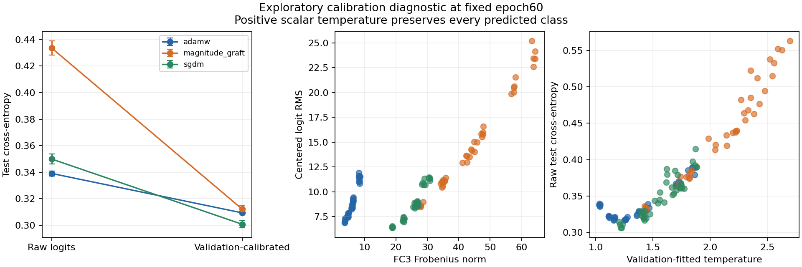
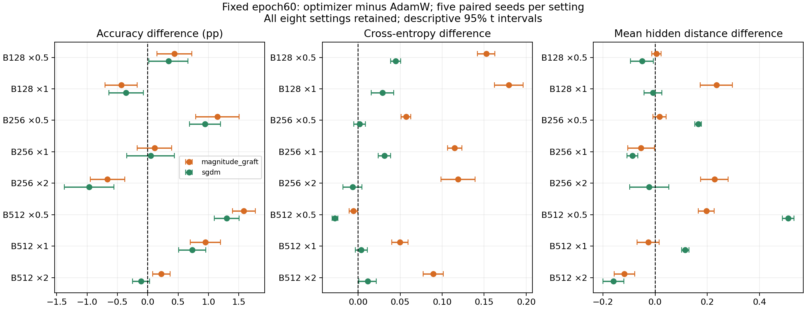
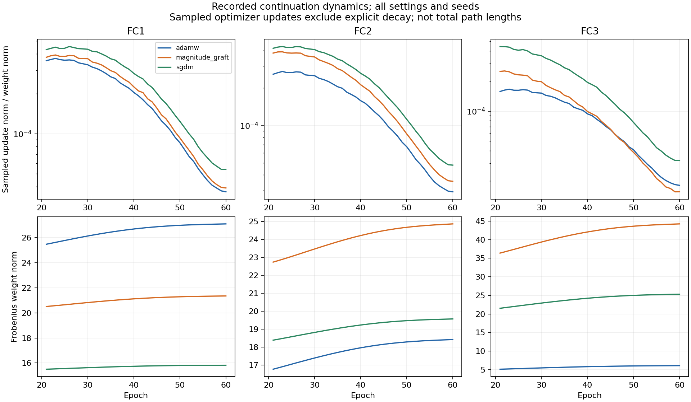

# Fashion-MNIST RETRY01: post-analysis

This is read-only, exploratory postprocessing of all120 fixed-epoch60 models (five paired seeds × eight settings × three arms), with their saved epoch20 endpoints and continuation statistics. No training, retuning, endpoint selection, or exclusion was performed. All original evidence remains unchanged.

## Main finding

The accuracy/CE contradiction is largely a confidence-scale issue. A positive scalar temperature fitted separately to each model’s **validation** logits reduces the graft-minus-AdamW test CE penalty from 0.094516 to 0.002842 nat (97.0% reduction of the mean gap). Predicted classes and every weight matrix are unchanged. The calibrated graft still has a small positive CE penalty: +0.002842 [0.000455,0.005229], paired95% t interval. This does not rescue alpha alignment or establish the RG mechanism.

| Arm | Raw test CE | Validation-calibrated test CE | Mean temperature | FC3 Frobenius norm | Centered logit RMS |
|---|---:|---:|---:|---:|---:|
| adamw | 0.33910 | 0.30940 | 1.370 | 6.076 | 8.963 |
| magnitude_graft | 0.43362 | 0.31224 | 2.086 | 44.275 | 14.821 |
| sgdm | 0.34996 | 0.30082 | 1.573 | 25.329 | 8.666 |

Temperature is fitted by minimizing full epoch60 validation CE over logT∈[−4,4], then applied once to saved epoch60 test logits. All fits are interior. The test set is reused and this diagnostic was selected after seeing the loss discrepancy. Calibration leaves the previously measured alphas unchanged. SGDM calibrated CE is below AdamW by0.008580nat [−0.012160,−0.005000]. These are postprocessed predictions, not new optimizer-training outcomes.

## Which settings drive the result?

Graft minus AdamW at epoch60. Positive accuracy favors graft; negative distance/CE favors graft. Full five-seed paired intervals are in [setting_effects.csv](results/setting_effects.csv). All eight settings remain in the analysis.

| Batch | LR multiplier | Accuracy difference (pp) | FC1 distance difference | FC2 distance difference | Mean hidden distance difference | CE difference |
|---:|---:|---:|---:|---:|---:|---:|
| 128 | 0.5 | +0.4400 | -0.0762 | +0.0859 | +0.0049 | +0.1524 |
| 128 | 1 | -0.4380 | +0.2134 | +0.2566 | +0.2350 | +0.1791 |
| 256 | 0.5 | +1.1480 | +0.0695 | -0.0364 | +0.0165 | +0.0570 |
| 256 | 1 | +0.1120 | -0.1349 | +0.0274 | -0.0538 | +0.1149 |
| 256 | 2 | -0.6640 | +0.2477 | +0.2063 | +0.2270 | +0.1191 |
| 512 | 0.5 | +1.5840 | +0.4464 | -0.0543 | +0.1960 | -0.0055 |
| 512 | 1 | +0.9500 | -0.0544 | +0.0006 | -0.0269 | +0.0498 |
| 512 | 2 | +0.2240 | -0.1809 | -0.0546 | -0.1177 | +0.0893 |

B128×1 and B256×2 have negative accuracy differences with intervals excluding zero, and worse FC1/FC2 alignment. B512×2 improves accuracy and mean hidden distance, but worsens CE. B512×0.5 improves accuracy and slightly lowers CE, but worsens hidden alignment. Thus no single average captures a uniform optimizer benefit. These descriptive contrasts do not justify discarding unfavorable settings.

## Measured update mechanism

The implemented graft is exactly a layer-dependent scalar gain on Adam’s matrix update: ΔW_graft = g_l ΔW_Adam, with g_l = η_SGDM,l ||momentum_l||F / ||ΔW_Adam||F, computed on the graft trajectory. The gain is directly recorded, not estimated by fitting alpha. Epoch means are averaged equally over epochs21–60, then over the eight settings within each seed. Recorded batches are the first two and every tenth; summaries are not exact whole-trajectory integrals.

| Layer | Graft gain over native Adam update on same trajectory | Graft Adam/SGDM direction cosine |
|---|---:|---:|
| FC1 | +1.06066 [+1.05038, +1.07093] | +0.71892 [+0.71265, +0.72520] |
| FC2 | +2.19322 [+2.16940, +2.21705] | +0.65395 [+0.64398, +0.66392] |
| FC3 | +9.64852 [+9.52792, +9.76911] | +0.62111 [+0.61763, +0.62459] |

The output-layer target magnitude is approximately9.65× the hypothetical native Adam magnitude **on the same graft trajectory**, compared with1.06× in FC1 and2.19× in FC2. This is an intentional consequence of the frozen layer rates[.04,.2,.8], not evidence that rates were accidentally reset. It makes the classifier head an important possible contributor to overconfidence. The endpoint head norm is44.27 for graft versus6.08 for AdamW; however, ReLU layer rescalings mean a head norm alone cannot establish causation. Centered logit RMS provides direct output-level evidence of larger prediction scale.

Relative step sizes decrease during continuation and are not exploding; SGDM relative steps are often larger than graft despite less severe CE. Thus the evidence does not support a simple claim that all graft steps are numerically too large. Optimizer directions also differ substantially: matching magnitude does not make the graft an SGDM update.

## Where the extra loss occurs

Across matched test examples, graft corrects290.975 AdamW errors and introduces249.025 errors per10000 examples, yielding41.95 fewer errors. But on examples both classify incorrectly, its excess CE contribution is+0.112078nat [0.107556,0.116600], exceeding the net+0.094516 gap. The other categories partly offset this. This is measured on the same examples, unlike independently selected worst1% sets. See [paired decomposition](results/error_decomposition_intervals.csv).

All40 graft models have higher final validation CE than at epoch20, versus24/40 AdamW and35/40 SGDM models. That is evidence of deteriorating probabilistic performance during this continuation; it does not imply every single epoch’s loss must decrease. The epoch of minimum validation CE is retained only as a descriptive field; no checkpoint is selected from it.

## Alpha aggregation and tail-range sensitivity

Graft FC1 mean alpha is closer to2, but the across-setting spread is larger: mean within-seed SD0.305 versus0.122 for AdamW. Opposite-side deviations cancel in the mean. Average individual distance is0.256 versus0.189; distance of the mean is0.071 versus0.187. The prior headline based only on average alpha would therefore be misleading.

Using the archived fixed-rank estimators changes some alignment conclusions. The following compares graft minus AdamW mean absolute distance of fixed-rank alpha from2. Five seed means over eight settings; neither range was selected based on performance.

| Layer | Top spectral fraction | Difference [95% interval] |
|---|---:|---:|
| FC1 | 20% | +0.12384 [+0.11054, +0.13713] |
| FC1 | 50% | -0.01463 [-0.01723, -0.01203] |
| FC2 | 20% | -0.01461 [-0.02877, -0.00046] |
| FC2 | 50% | +0.09353 [+0.07844, +0.10862] |

FC1 worsens using the top20% but improves using the top50%; FC2 has the reverse pattern. WeightWatcher’s original selected-tail fits and every raw spectrum remain unchanged. This demonstrates sensitivity to the spectral band and is a reason to examine the full spectral flow, not choose the estimator that supports the theory. Supported WW fits do not establish a globally exact power law.

The saved h−1 quantity is a **tail-shape proxy** defined by a fixed-rank mean log eigenvalue ratio. It is not the optimizer’s Jacobian trace-log and not a demonstrated residual of the theory’s RG condition. We have not measured a valid RG scale-equivariance residual in this post-analysis. Saved scalar norms cannot determine the Jacobian determinant; its state space, scaling transformation and treatment of moment histories must first be specified.

## What this resolves and what it does not

1. No new evidence of a coding or checkpoint-restoration error. The frozen source and existing independent verification are preserved.
2. The CE penalty is largely removable by a validation-fitted confidence rescaling, with unchanged accuracy and weights. This explains the apparent accuracy/CE contradiction much more directly than an alpha-only explanation.
3. Learning-rate/batch settings interact strongly with the intervention. The data support investigating the head magnitude and relative scaling, but do not establish an optimal setting or isolate a head-only causal effect.
4. Alpha alignment remains mixed and estimator-range-sensitive. This pass does not verify the proposed joint RG/alpha/generalization claim.
5. A future test would need a predeclared scale-condition observable and an isolated classifier-head intervention or balanced rate comparison. Such training was not run or scheduled here.

All intervals use five seeds, not40models as independent replicates. They are exploratory, unadjusted for multiple comparisons, and based on a reused test set. FC3 power-law alpha is unsupported due to10eigenvalues; its Frobenius norm is nevertheless directly measurable.

Reproduction: run `analyze.py --artifacts <directory containing the preserved seed archive folders and audit folder> --output results`, then `report.py`. [Checks](results/Post_Analysis_Checks.json) · [All numerical outputs](results/) · [Original verified report](../FINAL_VERIFIED_REPORT.md).

## Follow-up: importance-weighted spectral rescue

Charles clarified that improvement in layers far from2 should contribute more than small changes near2. The separately labeled [baseline-weighted analysis](weighted_alignment/REPORT.md) uses native AdamW distance as a fixed weight across treatments. It finds weighted FC1 improvement for graft, FC2 worsening and an unresolved combined effect; SGDM improves the combined score. This exploratory addition preserves the original metrics and all outcomes.
