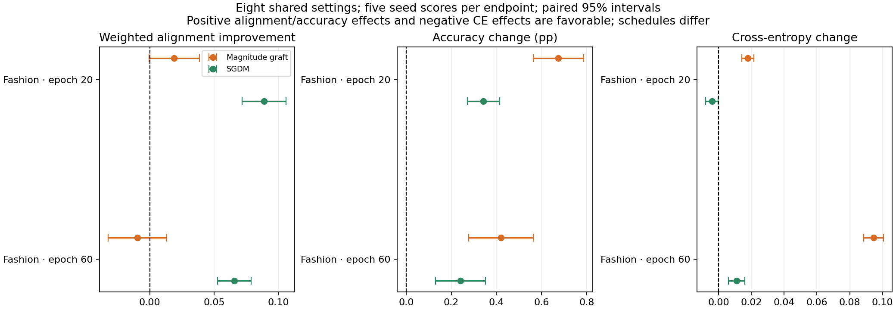
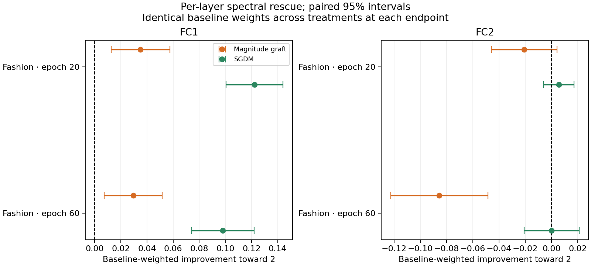

# Fashion-MNIST: weighted spectral rescue

Reproducible analysis of saved endpoints only. No new training or changed primary results.

## Metric and inference

For each matched layer, dA=|alpha_AdamW−2| and dT=|alpha_treatment−2|. The primary weight is w=dA. Within each seed, I=sum[w(dA−dT)]/sum[w]. Positive I means rescue toward 2. Baseline weights are identical across treatments. Combined scores sum both layers before normalization, rather than averaging separately normalized layer scores. Five seed scores are averaged equally; intervals use Student-t with 4 degrees of freedom. Model accuracy and CE contrasts remain ordinary paired seed means over settings, not severity-weighted performance claims.

The separately labeled sensitivity uses w=max(0,2−alpha_AdamW); treatment distance remains absolute so overshoot is penalized. Both weightings, both treatments and all settings are retained. No weighting exponent was tuned. Zero total weight or nonfinite scores remain undefined, never silently dropped. FC3 alpha is excluded because its fit has only 10 eigenvalues; unsupported hidden fits are labeled and retained.

This weighting was chosen after seeing results. Intervals are descriptive, unadjusted for multiple comparisons, and conditional on fixed datasets/splits/settings. Baseline-derived weights may amplify estimation noise/regression to the mean. The five seeds, not settings or layers, are the replicates. Weights are recomputed from native AdamW separately at each endpoint; cross-epoch score changes are not fixed-weight longitudinal effects. Fashion 20 and 60 are the same models and test set, not independent replication. The comparison is descriptive because dataset and learning-rate schedule differ.

## Eight shared settings

All values are mean differences [paired 95% interval]. Positive weighted improvement/accuracy is favorable; negative CE is favorable.

| Endpoint | Treatment | Weighted FC1 improvement | Weighted FC2 improvement | Combined improvement | Accuracy change (pp) | CE change |
|---|---|---:|---:|---:|---:|---:|
| fashion_e20 | Magnitude graft | +0.03506 [+0.01248, +0.05765] | -0.02097 [-0.04597, +0.00403] | +0.01902 [-0.00052, +0.03855] | +0.67475 [+0.56301, +0.78649] | +0.01780 [+0.01418, +0.02143] |
| fashion_e20 | SGDM | +0.12241 [+0.10063, +0.14419] | +0.00545 [-0.00614, +0.01705] | +0.08880 [+0.07183, +0.10577] | +0.34275 [+0.27125, +0.41425] | -0.00413 [-0.00787, -0.00038] |
| fashion_e60 | Magnitude graft | +0.02955 [+0.00736, +0.05173] | -0.08563 [-0.12263, -0.04863] | -0.00952 [-0.03221, +0.01317] | +0.41950 [+0.27635, +0.56265] | +0.09452 [+0.08849, +0.10054] |
| fashion_e60 | SGDM | +0.09806 [+0.07419, +0.12193] | +0.00003 [-0.02091, +0.02098] | +0.06575 [+0.05272, +0.07877] | +0.24050 [+0.13012, +0.35088] | +0.01086 [+0.00584, +0.01588] |

## Status and scope

- fashion_e20: 120 original endpoint rows; status counts {'USABLE': 120}; schedule: 5-epoch warmup; cosine to 10% peak at 20.
- fashion_e60: 120 original endpoint rows; status counts {'USABLE': 120}; schedule: Same epoch 20 states; low-rate cosine continuation to 1% peak at 60.

Fashion has 120 unique model trajectories with two endpoints, not 240 independent models. The continuation reused all epoch 20 model/optimizer/RNG states. Prior interrupted/superseded Fashion passes are separate historical experiments and are not pooled here. Their original files remain unchanged.

## Reproduce and inspect

Run `python reproduce.py` from this folder. This invokes the shared code and regenerates this dataset’s campaign outputs. Original source inputs and earlier reports are read-only.

[General comparison](../../../comparisons/README.md) · [Reusable analysis code](../../../comparisons/analysis/build.py) · [Source hashes](../../../comparisons/sources.lock.json) · [Numerical verification](campaign_results/Verification.json) · [All derived tables](campaign_results/).
