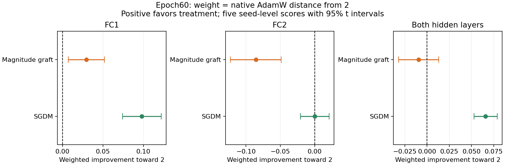

# Baseline-weighted alpha improvement

This exploratory metric was specified after inspecting the original experiment, following Charles’s clarification that rescuing layers far below2 matters more than small movements near2. All120 models and both hidden layers remain in the source data. This does not replace the original primary metric or create independent confirmation. No training, tuning or endpoint selection was performed.

For each paired layer and setting, let d_A=|alpha_AdamW−2| and d_T=|alpha_treatment−2|. The primary weight is w=d_A. Within each seed, compute I_s=sum[w(d_A−d_T)]/sum[w]. Positive I means improvement. The treatment uses the **same AdamW-derived weights**; never recompute weights from treatment alpha. Average the five seed scores equally and use Student-t intervals with4 degrees of freedom. The combined score sums FC1 and FC2 contributions before normalization, rather than averaging the two separately normalized layer scores.

Example:1.70→1.90 contributes0.30×0.20=+0.060 to the numerator.1.95→1.90 contributes0.05×(−0.05)=−0.0025. The first contribution is24 times larger in magnitude. A large worsening is still penalized.

A separately labeled sensitivity analysis uses w=max(0,2−alpha_AdamW), giving zero weight to baseline layers already at or above2. Treatment distance remains absolute, so large overshoots are penalized. Neither formula was selected based on which produces favorable results. We do not sweep weighting exponents.

## Epoch60: primary baseline-distance weighting

| Treatment | Layer(s) | Weighted AdamW distance | Weighted treatment distance | Improvement [95% interval] |
|---|---|---:|---:|---:|
| magnitude_graft | hidden_combined | 0.21226 | 0.22178 | -0.00952 [-0.03221, +0.01317] |
| magnitude_graft | fc1 | 0.25398 | 0.22444 | +0.02955 [+0.00736, +0.05173] |
| magnitude_graft | fc2 | 0.12887 | 0.21450 | -0.08563 [-0.12263, -0.04863] |
| sgdm | hidden_combined | 0.21226 | 0.14651 | +0.06575 [+0.05272, +0.07877] |
| sgdm | fc1 | 0.25398 | 0.15592 | +0.09806 [+0.07419, +0.12193] |
| sgdm | fc2 | 0.12887 | 0.12884 | +0.00003 [-0.02091, +0.02098] |

The graft improves weighted FC1 alignment, but worsens weighted FC2 alignment. Its combined hidden-layer effect is unresolved (interval includes zero). SGDM improves the combined weighted score. Thus weighting changes the interpretation of FC1, while it does not establish a joint graft benefit across both hidden layers. This metric addresses spectral rescue only; it does not establish accuracy or CE improvement.

## Sub-2-only sensitivity at epoch60

| Treatment | Layer(s) | Improvement [95% interval] |
|---|---|---:|
| magnitude_graft | hidden_combined | -0.01271 [-0.03548, +0.01006] |
| magnitude_graft | fc1 | +0.03311 [+0.00837, +0.05785] |
| magnitude_graft | fc2 | -0.13329 [-0.17920, -0.08738] |
| sgdm | hidden_combined | +0.08058 [+0.06937, +0.09179] |
| sgdm | fc1 | +0.10625 [+0.08913, +0.12338] |
| sgdm | fc2 | +0.00961 [-0.01751, +0.03672] |

[All weighted results, including epoch20](weighted_effects.csv) · [Five-seed scores](seed_scores.csv) · [Every paired-layer contribution](paired_layer_contributions.csv).

Weights are fixed across treatments **within each endpoint**, but separately computed at20 and60. Do not interpret their score difference as a fixed-weight longitudinal effect. The weights depend on observed AdamW alpha and can amplify baseline estimation noise/regression-to-the-mean; a future confirmatory analysis should prespecify the weighting and consider independently estimated baseline weights. Five seeds are the replicates; layers/settings are not independent replicates. CIs are descriptive and unadjusted for multiplicity. FC3 remains excluded because its alpha fit is unsupported.

Reproduce with `python analyze.py --endpoints <endpoints20_and60.csv> --output <directory>`. The input is the unchanged parent experiment results file.
