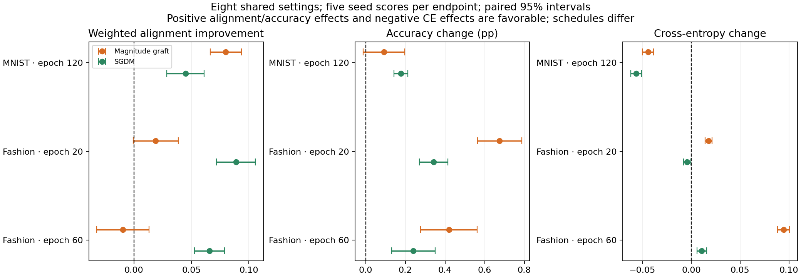
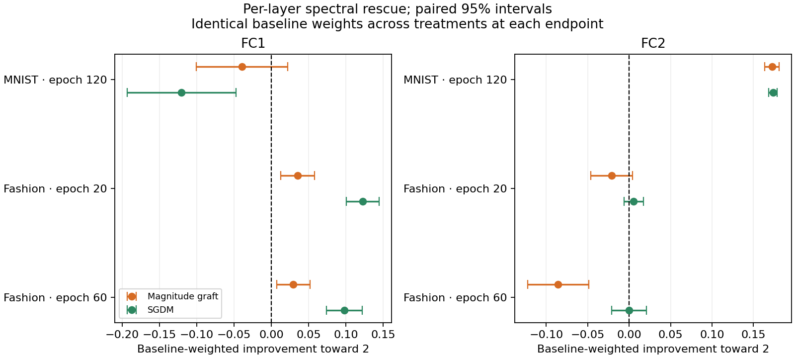

# Cross-experiment weighted spectral comparison

This folder compares the original MNIST experiment and the verified Fashion-MNIST endpoints. It is an extensible analysis registry, not a training launcher. All raw historical experiments, failure records and original primary analyses remain unchanged.

## RG paper results

[English results and plots](rg_paper/RESULTS.md) · [Tiếng Việt](rg_paper/RESULTS.vi.md) · [Run the reproduction](rg_paper/README.md)

## Dataset folders

- [MNIST: weighted report, code entry point and plots](../2026-11-13_mnist_mlp_experiment01/post_analysis/weighted_alignment/CAMPAIGN_REPORT.md)
- [Fashion-MNIST: weighted report, code entry point and plots](../2026-11-16_fashion_mnist_mlp_experiment02_extension_retry01/post_analysis/weighted_alignment/CAMPAIGN_REPORT.md)

## Shared-setting results

Eight settings × five seeds × three arms per endpoint. All values are mean [paired 95% interval]. The same native-AdamW baseline weights are used for graft and SGDM.

| Endpoint | Treatment | Weighted FC1 improvement | Weighted FC2 improvement | Combined improvement | Accuracy change (pp) | CE change |
|---|---|---:|---:|---:|---:|---:|
| mnist_e120 | Magnitude graft | -0.03958 [-0.10082, +0.02166] | +0.17236 [+0.16378, +0.18093] | +0.07998 [+0.06628, +0.09369] | +0.09125 [-0.01355, +0.19605] | -0.04425 [-0.04989, -0.03862] |
| mnist_e120 | SGDM | -0.12035 [-0.19311, -0.04760] | +0.17356 [+0.16842, +0.17870] | +0.04490 [+0.02860, +0.06119] | +0.17675 [+0.14193, +0.21157] | -0.05631 [-0.06189, -0.05072] |
| fashion_e20 | Magnitude graft | +0.03506 [+0.01248, +0.05765] | -0.02097 [-0.04597, +0.00403] | +0.01902 [-0.00052, +0.03855] | +0.67475 [+0.56301, +0.78649] | +0.01780 [+0.01418, +0.02143] |
| fashion_e20 | SGDM | +0.12241 [+0.10063, +0.14419] | +0.00545 [-0.00614, +0.01705] | +0.08880 [+0.07183, +0.10577] | +0.34275 [+0.27125, +0.41425] | -0.00413 [-0.00787, -0.00038] |
| fashion_e60 | Magnitude graft | +0.02955 [+0.00736, +0.05173] | -0.08563 [-0.12263, -0.04863] | -0.00952 [-0.03221, +0.01317] | +0.41950 [+0.27635, +0.56265] | +0.09452 [+0.08849, +0.10054] |
| fashion_e60 | SGDM | +0.09806 [+0.07419, +0.12193] | +0.00003 [-0.02091, +0.02098] | +0.06575 [+0.05272, +0.07877] | +0.24050 [+0.13012, +0.35088] | +0.01086 [+0.00584, +0.01588] |





## Interpretation

MNIST shows positive weighted rescue for the graft on the eight shared stable settings. Fashion epoch 60 shows FC1 rescue but FC2 deterioration; the combined graft interval includes zero. SGDM improves the combined weighted score in both datasets. A positive spectral result is not an accuracy or CE claim: the paired performance columns must be read separately.

MNIST ran 120 epochs; Fashion initially ran 20 and then continued the same states to 60 using a different low-rate schedule. Dataset and schedule effects cannot be separated here. Fashion 20 and 60 are dependent endpoints, not separate replications. MNIST’s shared eight-setting subset was previously chosen after discovering the failed batch 128/LR×2 graft setting. The MNIST report separately retains the full135-run grid and all138 original-plus-replication status records; full-grid spectral summaries never rehabilitate collapsed classifiers.

## Metric and inference

For each matched layer, dA=|alpha_AdamW−2| and dT=|alpha_treatment−2|. The primary weight is w=dA. Within each seed, I=sum[w(dA−dT)]/sum[w]. Positive I means rescue toward 2. Baseline weights are identical across treatments. Combined scores sum both layers before normalization, rather than averaging separately normalized layer scores. Five seed scores are averaged equally; intervals use Student-t with 4 degrees of freedom. Model accuracy and CE contrasts remain ordinary paired seed means over settings, not severity-weighted performance claims.

The separately labeled sensitivity uses w=max(0,2−alpha_AdamW); treatment distance remains absolute so overshoot is penalized. Both weightings, both treatments and all settings are retained. No weighting exponent was tuned. Zero total weight or nonfinite scores remain undefined, never silently dropped. FC3 alpha is excluded because its fit has only 10 eigenvalues; unsupported hidden fits are labeled and retained.

This weighting was chosen after seeing results. Intervals are descriptive, unadjusted for multiple comparisons, and conditional on fixed datasets/splits/settings. Baseline-derived weights may amplify estimation noise/regression to the mean. The five seeds, not settings or layers, are the replicates. Weights are recomputed from native AdamW separately at each endpoint; cross-epoch score changes are not fixed-weight longitudinal effects. Fashion 20 and 60 are the same models and test set, not independent replication. The comparison is descriptive because dataset and learning-rate schedule differ.

## Reproduction

From the repository root:

```bash
python -m pip install -r experiments/adamw_modified/comparisons/requirements.txt
python -m unittest discover -s experiments/adamw_modified/comparisons/tests -v
python experiments/adamw_modified/comparisons/analysis/build.py
```

A dataset folder also provides `reproduce.py`. Input SHA256 and Git-blob hashes are pinned in [sources.lock.json](sources.lock.json). The code fails on changed inputs, duplicate/missing pairs, unexpected seed grids or disagreement with the existing Fashion results. Zero-weight/nonfinite scores are explicitly undefined, never silently dropped. Sources are read only; no training package or network access is used.

## Adding another completed experiment

1. Preserve its source endpoints and model-status register in a new dated experiment folder. Export one row per seed/setting/arm/endpoint with columns `seed,batch_size,multiplier,arm,epoch,alpha_fc1,alpha_fc2,test_accuracy_pct,test_loss,status` plus hidden-fit support counts/flags. Use `USABLE`/`FAILED` as functional labels independently of alpha.
2. Add its dataset/endpoint entry to [experiments.json](experiments.json), with source paths, output analysis folder, seed list, hidden layers, schedule, and dependence group. Use the same dependence group for continuations of the same models. Do not silently pool incomplete grids or invent independent seeds.
3. Inspect the new source files and run `analysis/build.py --refresh-lock --source-commit <reviewed_Git_commit>` once to pin their current hashes and rebuild. Refreshing is explicit; normal builds refuse changed inputs. For a different setting grid or architecture, define the comparison design before interpreting results; the present registry is a matched MLP grid.
4. Inspect the new plots, verification and failure registers before committing. New entries do not start or authorize training.

[All numerical tables](results/) · [Verification](results/Verification.json) · [Shared calculation module](analysis/weighted.py) · [Scientific invariant tests](tests/test_weighted.py).
