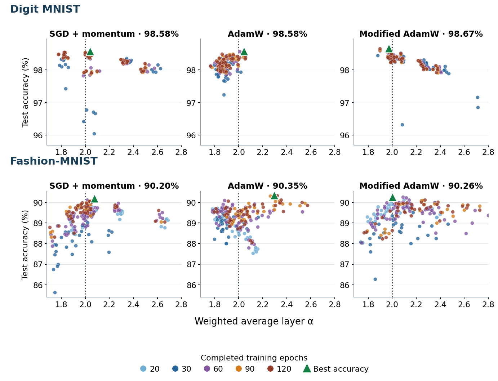

# Reproduce the RG optimizer figures and tables

[English results](RESULTS.md) · [Kết quả bằng tiếng Việt](RESULTS.vi.md) · [Machine-readable results](results.json) · [Data dictionary](INPUTS.md)

On digits, the momentum baseline gives weighted average α = 2.025. AdamW gives 1.855, and modified AdamW gives 2.043. On Fashion the correction raises α on both schedules. It moves α toward 2 on the continuation and away from 2 on the original schedule.



## Run from a download

Extract the GitHub ZIP or clone this branch and change into `experiments/adamw_modified/comparisons/rg_paper/`. Use Python 3.12:

```sh
python -m venv .venv
. .venv/bin/activate
python -m pip install -r requirements.txt
python reproduce.py
```

On Windows PowerShell, activate the environment with `.venv\Scripts\Activate.ps1`. After installing the listed packages, the replay needs no network, credentials, GPU or model training. It verifies the input hashes, refits 3,510 archived layer spectra, recounts ERG gaps, checks checkpoint selection and calibration, writes `build/results.json`, and generates `build/optimizer_figures.pdf` plus 3 PNGs. Figure 17 embeds the original image. [View Figure 16](plots/figure16_erg_gap.png) · [View Figure 17](figure9_mnist_optimizer_comparison_panelgrid.png) · [View Figure 18](plots/figure18_muon_30.png)

## Experiment folders

The training code and original reports are under [experiments/adamw_modified](../../) in the dated folders. Three arms share a sweep: `sgdm`, `adamw`, and `magnitude_graft` (modified AdamW).

| Dataset or experiment | Folder | Records used here |
|---|---|---|
| Digit MNIST | [Original sweep](../../2026-11-13_mnist_mlp_experiment01/) | 135 runs × 4 saved epochs, plus a separate batch-128 replication for confidence analysis |
| Fashion-MNIST | [Original sweep and recovery](../../2026-11-15_fashion_mnist_mlp_experiment02/) | 341 saved checkpoints, 84 runs at epoch 120 |
| Fashion continuation | [Epoch 20](../../2026-11-15_fashion_mnist_mlp_experiment02_clean/), [epoch 60](../../2026-11-16_fashion_mnist_mlp_experiment02_extension_retry01/), [epoch 120](../../2026-11-16_fashion_mnist_mlp_experiment02_epoch120_noaug/) | 120, 120 and 49 checkpoints, respectively |
| Confidence and augmentation | [Fashion paired](../../2026-11-16_fashion_mnist_adamw_paired120/), [augmented digits](../../2026-11-16_mnist_adamw_augmented120/), [scale-equivalence follow-up](../../2026-11-16_fashion_mnist_mlp_experiment02_extension_retry01/follow_up/2026-11-16_scale_equivariance/) | Additional paired predictions |
| Muon, 30 epochs | [Executed 3-seed notebook](../../../../baseline/notebooks/MNIST_MLP3_SGD_Momentum_Muon_Horizon_Optimized.out.ipynb) | Layer α and ERG-gap means and ranges |
| Muon, 500 epochs | [Included executed notebook](notebooks/AdamWvsMuon.ipynb) | Original published trajectory and printed numeric checkpoints |

The [first Fashion extension attempt](../../2026-11-16_fashion_mnist_mlp_experiment02_extension/) ended before training resumed. The [Tiny Shakespeare pilot](../../2026-11-15_tiny_shakespeare_gpt_experiment03/) is a separate experiment. Neither contributes rows to the paper.

## Inputs and provenance

* `optimizer_checkpoints.csv` contains 1,170 model checkpoints × 3 layers. Use `cohort,seed,batch,rate,arm,epoch,layer` as the row key. Test accuracy is a percentage. Each signed ERG gap equals `k_erg - k_pl` eigenvalues. The model average weights each layer α by `sqrt(k_pl)/(D + 0.02)`.
* `validation_endpoints.csv` lists validation accuracy for all 268 completed epoch-120 checkpoints, including all candidates for each validation-selected winner.
* `confidence_run_pairs.csv` contains 292 run-level comparisons between epochs 60 and 120. Confidence gaps are on a 0–1 scale. The checker summarizes high-confidence predictions for runs whose accuracy moved by at most 0.25 percentage points.
* `muon_30_epochs.csv` supplies the separate three-seed curves. `Muon_500_Reported.csv` contains the numeric rows printed by the long-run notebook. The long run saved layer α without per-layer tail counts and KS fit distances. The paper reports the equal-weight average and sample SD across its 3 layers.
* Figure 17 uses the [original paper figure](https://github.com/CalculatedContent/rg_theory_paper_arxiv/blob/2d5e752c65188bf8a194163a01b76839b516252d/figures/figure9_mnist_optimizer_comparison_panelgrid.png). The included PNG is the same Git blob, `82977f95f6b4f06f28bca42eb4c22fd150806995`. [Pinned sources](verified_sources.tsv) identifies the original experiments, notebooks and figure.
* With the historical checkpoint archives, run `python rg_gap_audit.py --verify-paper /path/to/seed-archives layer_gaps.csv.gz` to recompute per-layer ERG counts from the Gram spectra and stored tail fits. Some raw archives require owner access or were distributed as time-limited Actions artifacts. The compact tables suffice for the figure and table checks above. The paired unaugmented Fashion logits and labels are included. For the full 292-pair calibration count, the replay uses the shipped per-run confidence totals. Inspecting all underlying per-image logits requires the historical archives.
