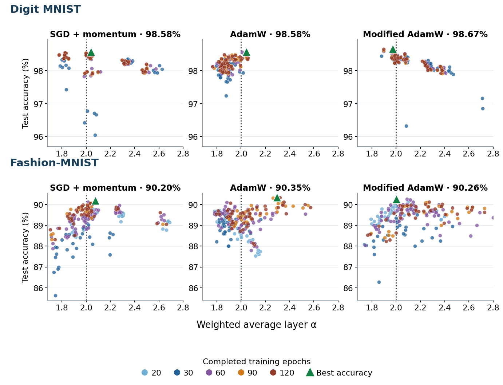
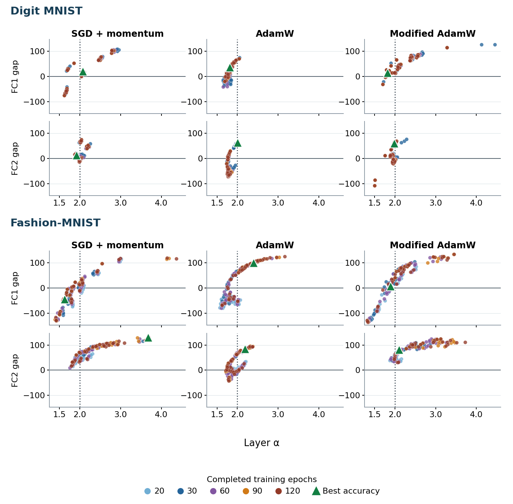

# What the optimizer experiments show

[Tiếng Việt](RESULTS.vi.md) · [Machine-readable results](results.json) · [Run the checks](README.md)

At epoch 120, SGD with momentum puts the confidence-weighted, tail-adjusted average layer α near 2 on both datasets. Keeping AdamW’s direction and restoring the momentum step length raises average α in all 3 matched comparisons. This recovers a value near 2 on digits and on the Fashion continuation. On the original Fashion schedule AdamW already finishes above 2, and the correction pushes it higher.

| Dataset and schedule | Matched seeds | SGD + momentum | AdamW | Modified AdamW |
|---|---:|---:|---:|---:|
| Digit MNIST | 5 | 2.025 | 1.855 | 2.043 |
| Fashion-MNIST, original | 3 | 1.992 | 2.188 | 2.646 |
| Fashion-MNIST, continuation | 2 | 2.016 | 1.867 | 2.067 |

Each entry averages the checkpoint-level weighted α over the same seeds at batch size 256 and the nominal learning rate. All 5 matched digit runs move closer to 2 with the correction. Across the wider sweeps the best Fashion AdamW checkpoint reaches 90.35% test accuracy at average α = 2.296. Modified AdamW reaches 90.26% at 2.002. Figure 15 pools schedules and colors dots by epoch. One green triangle marks the highest test accuracy per panel. An exact tie goes to the average α closest to 2.

**The ERG gap counts eigenvalues.** At epoch 120, 246 of 254 hidden layers with α > 2 have a positive gap. Of 282 with α < 2, 133 have a negative gap. The closest digit fit has α = 1.99953 and a gap of +1. On Fashion, a fit at 2.00069 has a gap of +38. These observations support the spectral target while leaving open how normalization affects the residual count.

**Muon continues to change after accuracy settles.** From epoch 200 to 500, the unweighted average of FC1, FC2 and FC3 moves from 2.402 ± 0.339 to 2.124 ± 0.170 as test accuracy moves from 99.23% to 99.22%. The spread is the sample standard deviation across 3 layers. Figure 17 preserves the original notebook plot. Figure 18 comes from a separate 30-epoch, 3-seed experiment. [Figure 17](figure9_mnist_optimizer_comparison_panelgrid.png) · [Figure 18](plots/figure18_muon_30.png)

**Accuracy can stay steady while confidence drifts.** Among the 75 qualifying Fashion runs, the gap between confidence and observed accuracy widened for predictions scored at least 99% confident. The hardest tenth of images accounted for 91.26% of the increase in test log loss in the 2 unaugmented Fashion AdamW runs. The other seed’s epoch-60 predictions select that tenth independently for each run.

## Independent checks

The code refits every layer from its eigenvalues, selects its tail cutoff, reconstructs its KS distance and confidence weight, and recounts the ERG gap. Input-level calibration counts support the 292 run-pair comparisons. Per-image losses support the hardest-tenth result. Figure 17 uses the archived image because the long-run notebook preserved selected numeric checkpoints and the plotted trajectory. Full training replay and original per-image logits have separate archive requirements. [Data dictionary and scope](INPUTS.md)
