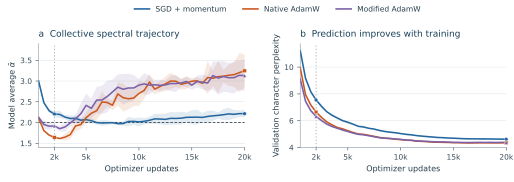
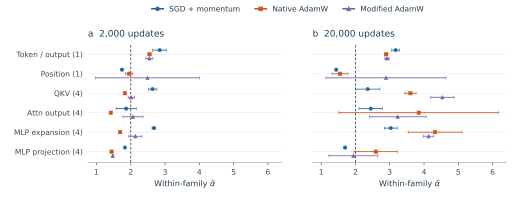
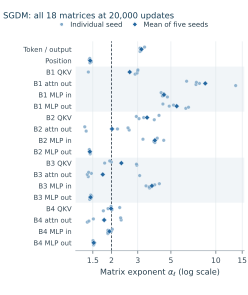

# Shakespeare GPT: three optimizers, five seeds each

Completed GitHub Actions results at 2,000 and 20,000 optimizer updates. This directory consolidates the scientific results and their regeneration scripts; the manuscript remains separate. All primary statistics use the fresh GitHub cohorts, seeds 1340–1344. No new training was launched for this summary.

## Main result

Modified AdamW gives the lowest validation character perplexity at 2,000 updates in every matched seed. Native AdamW gives the lowest at 20,000 in every matched seed. SGDM stays nearest the marginal model-average regime after initial relaxation, with worse perplexity at both checkpoints. Both AdamW variants later drift onto the weak-tail side (mean alpha greater than 2) while validation prediction continues improving.

Uncertainty below is the 95% Student-t confidence interval of the equally weighted mean over five seeds (df=4). It is not dispersion across layers. Lower cross-entropy and character perplexity are better.

| Recipe | Updates | Weighted alpha, mean ± CI half-width | Alpha sample SD | Validation character PPL, mean ± CI half-width | PPL sample SD |
|---|---:|---:|---:|---:|---:|
| SGD + momentum | 2,000 | 2.204359 ± 0.073953 | 0.059560 | 7.543061 ± 0.080721 | 0.065011 |
| Native AdamW | 2,000 | 1.640901 ± 0.006738 | 0.005426 | 6.642490 ± 0.074168 | 0.059733 |
| Modified AdamW | 2,000 | 1.915077 ± 0.046388 | 0.037360 | 6.317157 ± 0.156422 | 0.125978 |
| SGD + momentum | 20,000 | 2.213622 ± 0.086760 | 0.069874 | 4.609264 ± 0.049570 | 0.039922 |
| Native AdamW | 20,000 | 3.247494 ± 0.393972 | 0.317293 | 4.341996 ± 0.033591 | 0.027053 |
| Modified AdamW | 20,000 | 3.131151 ± 0.375255 | 0.302220 | 4.374646 ± 0.021568 | 0.017370 |

The matched-seed modified-minus-native PPL difference is −0.325333 (95% CI [−0.446842, −0.203825]) at 2,000 updates and +0.032650 ([0.007551, 0.057748]) at 20,000. These are paired seed contrasts under a common frozen design and recorded GitHub runtimes; the workers did not share an identical CPU host.

## Trajectories and layers



Means and pointwise 95% Student-t confidence bands over five seeds. The plotted measurements begin at update 500; initialization is retained in the CSV files. The horizontal axis is optimizer updates, not epochs: minibatches sample windows with replacement.



Within each seed, each family uses the same confidence-tail weights restricted to its matrices, followed by equal weighting of seeds. Each transformer family contains four matrices; each embedding family contains one. Family means are not averaged equally to construct the model mean.



All 90 SGDM endpoint fits (18 matrices × five seeds), with per-matrix arithmetic seed means. The alpha axis is logarithmic and includes the full observed range, 1.323–13.568. Forty of the 90 fitted exponents are below 2. This layer heterogeneity is distinct from seed uncertainty in a model average.

SGDM’s recorded mean after 2,000 updates ranges from 1.974114 to 2.214505; its 20,000-update CI [2.126862, 2.300382] excludes exactly 2. Native AdamW has a minimum mean of 1.614671 at 2,500 updates; modified AdamW has 1.851392 at the same update. Neither AdamW trajectory remains near 2 at the endpoint. Alpha drift describes spectral behavior, not an observed divergence of validation loss.

## Primary cohorts and permanent archives

| Recipe | Completed Actions run | Pinned result commit | Experiment directory |
|---|---|---|---|
| Native AdamW | [45393623223](https://github.com/CalculatedContent/rg_optimizers/actions/runs/45393623223) | [`163980048ab7`](https://github.com/CalculatedContent/rg_optimizers/commit/163980048ab7381e02b97a8620b25ddefa52b613) | [2026-11-24_adamw_replay](https://github.com/CalculatedContent/rg_optimizers/tree/163980048ab7381e02b97a8620b25ddefa52b613/short_test_adamw_graft/experiments/2026-11-24_adamw_replay) |
| Modified AdamW | [45375423863](https://github.com/CalculatedContent/rg_optimizers/actions/runs/45375423863) | [`e0440e5a42dc`](https://github.com/CalculatedContent/rg_optimizers/commit/e0440e5a42dc6ba7f19d2d170f1a0d7551a16410) | [2026-11-24_five_seeds](https://github.com/CalculatedContent/rg_optimizers/tree/e0440e5a42dc6ba7f19d2d170f1a0d7551a16410/short_test_adamw_graft/experiments/2026-11-24_five_seeds) |
| SGD + momentum | [45386899611](https://github.com/CalculatedContent/rg_optimizers/actions/runs/45386899611) | [`23ba932c01d6`](https://github.com/CalculatedContent/rg_optimizers/commit/23ba932c01d63653985c28ef9df5ef3804ee4297) | [2026-11-24_sgdm_replay](https://github.com/CalculatedContent/rg_optimizers/tree/23ba932c01d63653985c28ef9df5ef3804ee4297/short_test_adamw_graft/experiments/2026-11-24_sgdm_replay) |

All three workflows succeeded. Every primary run has 41 measurements (0, 500, …, 20,000), each with 18 successful unique matrix fits: 615 model measurements and 11,070 matrix fits in total. The modified cohort records `complete_five_seeds=true`, `n_completed=5`; each replay records five completed seeds. The historical modified seed1340, historical controls, failed recovery45373421406, and local partial workers are excluded from the primary means.

The native AdamW result commit already contains the complete modified and SGDM directories unchanged, including checkpoint archives. The inventory in `data/checkpoint_inventory.json` records all 15 archive paths, Git blob hashes and byte sizes. Each retains weights at both 2,000 and 20,000 updates. This consolidation verified tree identities and provenance; it did not download every binary archive again. Original per-seed archival metadata retains checkpoint SHA-256 values where recorded.

## Fixed protocol

- Frozen training source: `b306247d1b0078a18b1539c68ba14bb64d41a079`, bundled under the modified experiment’s `frozen_source` directory.
- Character GPT: 4 blocks, 4 heads, width128, context64, vocabulary65, no dropout/bias, tied token/output embedding; 804,096 unique parameters.
- Tiny Shakespeare contiguous90/5/5 split; batch12 windows; fixed seed labels1340–1344; float32 CPU; one numerical thread per worker.
- Native AdamW: peak learning rate0.001, betas(0.9,0.99), epsilon1e-8, weight decay0.
- SGDM baseline: peak0.1, momentum0.9, weight decay0, no Nesterov or dampening.
- Modified AdamW: same adaptive direction, per-transformer-matrix Frobenius update norm matched to a momentum0.9 SGDM reference at peak0.4; rate ratio400. Reference gradients follow the modified trajectory. The16 transformer matrices are grafted; embeddings and normalization parameters retain native AdamW.
- All recipes:100 warmup updates; cosine decay to0.1×peak at17,000; constant through20,000; global gradient clipping1.0. The2,000 checkpoint is an intermediate point on this unchanged long schedule.
- Calibration precedes the confirmation cohort. No settings were selected from confirmation-seed results.

## Estimators and uncertainty

For every checkpoint, use ordinary fitted `alpha` with `w = sqrt(num_pl_spikes)/(D + 0.02)` over all18unique matrices, then compute `sum(w * alpha) / sum(w)`. Count the tied token/output embedding once. Do not use WeightWatcher’s `alpha_weighted`, do not add matrix-size weights, and do not pool layers across seeds to form an error bar.

Seed means receive equal weight. Sample SD uses `ddof=1`; the95% confidence half-width is `2.7764451051977987 * SD / sqrt(5)`. Trajectory intervals are pointwise, not simultaneous. PPL is exponentiated separately for each seed’s full validation CE and then averaged.

## Recalculate without training

From this summary directory, use Python3 and run:

```bash
python download_cohorts.py
python recompute_statistics.py
python -m pip install numpy pandas matplotlib
python make_figures.py
```

`download_cohorts.py` reads pinned GitHub commits and checks downloaded bytes against Git blob hashes. `recompute_statistics.py` uses only the Python standard library, verifies every matrix fit and cohort identity, and checks the reconstructed values against the committed analyses. `make_figures.py` creates PDF, PNG and SVG figures from those verified CSV files. It does not refit spectra or train a model. The raw histories and full per-matrix CSV are reconstructed by the first two commands.

For training from scratch, follow [reproduction_protocol.md](reproduction_protocol.md). This directory includes the exact frozen source, corpus, pinned requirements and a safe checkpoint-resume convenience launcher under `data/protocol/`. The launcher calls the unchanged training functions and uses separate output directories. It did not produce the primary cohort. The original experiment READMEs, entry points and workflows remain at the pinned revisions above.

## Runtime and historical replay

The primary jobs record Python3.12.14, PyTorch2.14.1+cpu and WeightWatcher0.7.7. Host metadata show that identical package versions need not imply identical CPU kernels. Modified jobs recorded heterogeneous Intel/AMD CPUs; the native and SGDM replays record runner images without full CPU model capture.

The recorded `training_seconds` totals cover the training update calls, not full elapsed job time. They range590–1425seconds (9.8–23.8minutes); validation, spectral fitting, setup and archival add overhead.

The fresh native AdamW means closely reproduce historical PPL:6.642490 vs6.642759 at2k and4.341996 vs4.339258 at20k. Its20k alpha mean is3.247494 vs3.243049, but its seed SD is0.317293 vs0.092073, so the replay does not establish identical seed dispersion. Historical2k alpha was not retained and is not invented. Karpathy’s contextual approximate loss1.88 implies PPL≈6.55; its split, sampled evaluation, decay and schedule differ, and the reported loss split is unspecified. See the original committed `data/original_comparison_audit.json` in the experiment input archive.

## Files

- `data/endpoint_summary.csv`: mean, sampleSD, SEM and95% CI at2k/20k, including CE/PPL/top1accuracy.
- `data/per_seed.csv` and `data/trajectory.csv`: all615 model records and123 trajectory summaries.
- `data/family_summary.csv`: within-family weighting followed by seed uncertainty.
- `data/verified_summary.json`: endpoints, matched-seed contrasts and verification counts.
- `data/source_manifest.json`: pinned source URLs and byte identities.
- `data/checkpoint_inventory.json`: permanent archive inventory.
- `data/INDEPENDENT_AUDIT.md`: audit method, checks and provenance distinctions.
